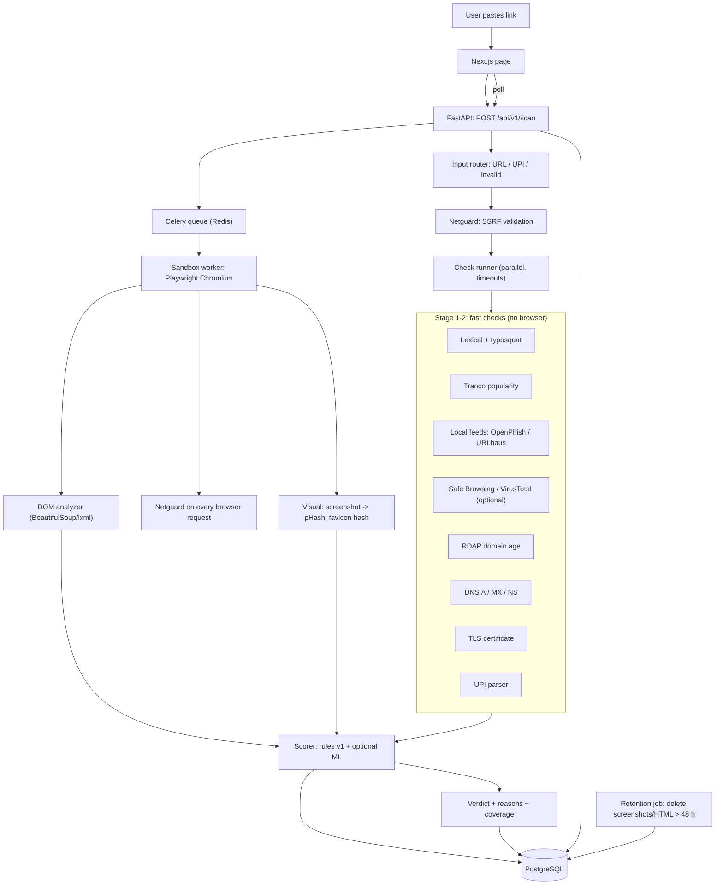
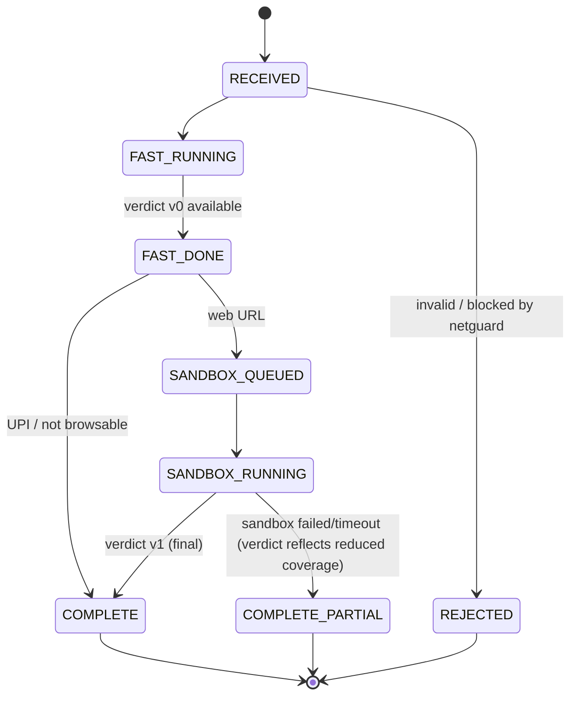

# TrueIntent Link Analyzer (Module B) — Rebuild Specification

> Status: authoritative design for the **rebuild**. This document supersedes earlier design notes wherever they conflict (see section 3.4 for the one big change: the system now gives a verdict).
> Audience: the student team, the AI coding tool, and the evaluators/judges.
> Companion file: `AI_CODING_PROMPTS.md` (the phase-by-phase build prompts).

---

## 1. What this project is, in plain words

A person receives a link (SMS, WhatsApp, email, a QR code, a "refund" UPI link). They are not sure whether it is safe. They paste it into our web page. Our system:

1. Studies the **text of the link** (does it look like a fake of a bank or shop?).
2. Looks up **who owns the domain and how old it is**, where it points, and whether its certificate looks normal.
3. Checks the link against **known bad lists** (local copies of free phishing feeds, plus Google Safe Browsing and VirusTotal when keys are available).
4. **Visits the page inside a locked-down robot browser** (a sandbox), without ever typing anything into it, and records what the page contains: password boxes, card boxes, UPI boxes, where forms send data, which brand it pretends to be, hidden frames, urgent language, and a visual fingerprint of the page.
5. Combines everything into a **verdict** — `LIKELY SAFE`, `SUSPICIOUS`, `DANGEROUS`, or `UNKNOWN` — with a plain-language list of reasons, and shows the evidence.

This is **Module B** of the larger TrueIntent system (Authorized Push Payment fraud detection). In TrueIntent it later feeds the unified fusion layer (Module D) as one signal vector. It must also work **on its own** as a complete product, because that is what we can demo and defend.

### 1.1 Why it matters
Banks verify *identity* (OTP, biometrics). Scammers exploit *intent*: the victim willingly authenticates a payment because a fake page or fake link told them to. A link checker attacks the very first step of that chain.

### 1.2 The one-sentence pitch (for judges)
"Paste a link; our sandbox visits it safely, combines address, registration, reputation, and page-behaviour evidence, and returns a verdict with reasons you can verify — and when it cannot be sure, it says UNKNOWN instead of pretending."

---

## 2. Honest starting point: why the current version does not work

From the existing summary and journal (chapters 0–10), the current Module B is *architecturally careful but functionally hollow*:

| # | Observed problem | Root cause | Fix (phase) |
|---|---|---|---|
| 1 | Technical URL checks return `CHECK_UNAVAILABLE` | The lexical analyzer module (`app.core.lexical`) was only a stub | Phase 2 |
| 2 | Threat feeds return `THREAT_FEED_UNAVAILABLE` | No API keys, no local feeds | Phase 3, 4 |
| 3 | Domain age often `UNKNOWN` | WHOIS is flaky; short timeouts; unusual TLDs | Phase 4 (RDAP + caching + honest "weak" handling) |
| 4 | Result feels "Inconclusive" for almost everything | One failed check drags the whole result; score is an uncalibrated placeholder; no verdict | Phase 1, 8 |
| 5 | Visual check rarely informative | Brand hash references are empty or tiny | Phase 7 |
| 6 | Nothing to show a user | Next.js frontend is a placeholder | Phase 10 |
| 7 | Never tested end-to-end on real links | Evaluation used 40 synthetic examples | Phase 9, 12 |
| 8 | Possibly the browser sandbox itself fails in Docker | Chromium not installed / wrong image / missing flags (to be confirmed in Phase 0) | Phase 0, 5 |

**Design lesson:** a security tool that returns "I don't know" for every input is useless. A security tool that says "SAFE" without evidence is dangerous. The rebuild's job is to sit between those: *every check is independent, bounded in time, and reports what it saw; the verdict uses whatever succeeded and admits what it could not do.*

---

## 3. Goals, non-goals, and what "WORKING" means

### 3.1 Goals
- G1. Accept a pasted URL (and UPI deep link) and return a **verdict + reasons + evidence** within ~25 seconds for a typical page (fast result in ≤3 s, sandbox findings appended later).
- G2. Catch the common scam-link patterns relevant to India: bank/UPI/e-commerce/government brand impersonation, fresh domains, typosquats, credential/payment harvesting forms, UPI collect disguised as a refund, URL shorteners hiding the target.
- G3. Never crash or return "Inconclusive" merely because one external service is down.
- G4. Be **measurable**: a reproducible evaluation with precision, recall, false-positive rate, and a confusion matrix on a domain-disjoint test set.
- G5. Be **safe to run**: a hostile link must not be able to attack our server (SSRF, downloads, resource exhaustion).
- G6. Be **demoable** by a non-expert in two minutes (web page, not only an API).
- G7. Be **documented as it is built** (journal appended every phase, code pushed to GitHub every phase).

### 3.2 Non-goals (stated in the report as honest limitations)
- Residential proxy networks, geo-egress countries, physical mobile device farms.
- Billions of historical hostnames, crowdsourced scan submissions, petabyte storage.
- Curated signatures for 3,000+ brands (we do **20–30** brands).
- Guaranteeing detection of phishing kits that cloak (serve harmless pages to datacenter IPs).
- Verifying that a *company* is genuine. We provide **trust signals**, not proof.

### 3.3 Definition of "WORKING" (acceptance criteria for the whole project)
The project is considered working when **all** of these are true and demonstrated:

1. `docker compose up` starts the full stack on a fresh clone with one command after copying `.env.example` to `.env`.
2. Pasting `https://www.google.com` returns `LIKELY SAFE` with reasons (high popularity, old domain, no feed hit).
3. Pasting a currently-listed phishing URL from a feed (or its locally hosted replica test page) returns `DANGEROUS` or `SUSPICIOUS` with at least two independent reasons.
4. Pasting a made-up typosquat such as `http://sbi-secure-login-verify.xyz/` returns `SUSPICIOUS` or `DANGEROUS` even if the host does not exist (lexical + typosquat + TLD signals).
5. Pasting `upi://collect?pa=...&am=5000&tn=refund` is flagged as a collect request with explanation.
6. With **no API keys at all**, the system still returns a verdict (never a blanket "Inconclusive"); with keys, it uses them.
7. Killing Redis-cache, blocking WHOIS/RDAP, or blocking Safe Browsing does not crash the scan; affected checks show `unavailable` and the verdict states reduced coverage.
8. The evaluation report on a domain-disjoint held-out set is committed, with the numbers produced by the committed script. (Target: phishing recall ≥ 85% at false-positive rate ≤ 5% for the hybrid scorer. If the target is missed, the report states the real numbers and why; we never edit numbers.)
9. The SSRF test suite passes (localhost, private ranges, metadata IP, redirects to private IPs, DNS rebinding mitigation where feasible).
10. A Next.js page lets a user paste a link and see the verdict, reasons, evidence table, and (temporary) screenshot.
11. The journal has one chapter per phase, and GitHub shows a commit/tag per phase.

### 3.4 Important design change: from "indicators only" to "verdict + honesty"
Earlier chapters decided to "report indicators, not verdicts" because the score was uncalibrated. That was reasonable for a prototype and is **reversed** now, because users need a decision and the project needs to be a working model. The honesty is preserved differently:
- The verdict has four states including `UNKNOWN`.
- The numeric risk score (0–100) is labelled a **heuristic risk score, not a probability**, until calibrated in Phase 9.
- Every verdict carries a **coverage** field (how many independent checks actually ran) and a list of reasons.
- `LIKELY SAFE` is never shown as "SAFE" and always carries the sentence "No warning signs found by the checks that ran; this is not a guarantee."

Phase 1 must record this reversal in the journal's decision table.

---

## 4. Users and use cases

| User | Scenario | What they need |
|---|---|---|
| Elderly person / non-technical | WhatsApp message "KYC expires today, click here" | Big clear verdict, 3 plain reasons, "call your bank on its official number" |
| Student / young adult | "Refund" UPI collect link | Explanation of what a collect request does |
| Bank fraud analyst (stretch) | Triage a reported link | Evidence table, indicators, JSON export |
| Judge / evaluator | Two-minute demo | Fast verdict, visible reasons, honest limitations, metrics |
| TrueIntent Module D | Needs a link-risk signal | Stable `signal_vector` JSON |

---

## 5. Learning from urlscan.io: copy, adapt, skip

urlscan.io works like a *malware sandbox for URLs*: submit → scan ID → headless browser visits → records network, DOM, screenshot → organic verdict from rules + brand signatures → searchable archive.

| urlscan.io capability | Our decision | How we do it at student scale |
|---|---|---|
| Async scan returning `scanId` | **Copy** | `POST /api/v1/scan` → `scan_id`; poll `GET /api/v1/scan/{id}` |
| Headless Chromium visit, follows redirects | **Copy** | Playwright, per-scan fresh context, 15 s budget |
| Redirect chain, final URL | **Copy** | Recorded from navigation/response events |
| Contacted domains/IPs, request log | **Adapt** | Domains + counts + third-party ratio; not full waterfall storage |
| Rendered DOM snapshot | **Adapt** | Parse in memory with BeautifulSoup/lxml; store only extracted features and a short text excerpt |
| Screenshot | **Adapt** | Kept 24–48 h for display, then deleted; only the perceptual hash is long-term |
| TLS certificate capture | **Copy (light)** | Python `ssl` handshake: issuer, not-before, SAN match |
| Favicon hash | **Copy** | Hash favicon; compare to brand references |
| File hashing (SHA-256) of resources | **Adapt** | Hash main document and scripts count only (optional) |
| Brand impersonation engine (3,000+ brands) | **Adapt** | 20–30 brands: official domains, keywords, logo/page pHash |
| Visibility tiers (public/unlisted/private) | **Adapt** | Default private; no public feed |
| Elasticsearch search & pivoting | **Skip / light** | PostgreSQL tables with indexes on domain and hash; simple "similar scans" query optional |
| Saved searches, incidents, live scanning, feeds | **Skip** | Mentioned as future work |
| Residential proxies, geo egress, real devices | **Skip** | Documented limitation |
| 6.5B hostnames, 3M scans/day | **Skip** | Cold-start problem acknowledged; we ship with local feeds + Tranco |

**The key insight:** urlscan.io's *core loop* (visit in sandbox, extract features, match brands, produce verdict) is reproducible; its *scale* is not. We replicate the loop and be honest about scale.

---

## 6. System architecture



### 6.1 Components
- **FastAPI backend** — request validation, orchestration, persistence, polling endpoint.
- **Input router** — decides: web URL, UPI deep link, bare domain (auto-prefix `http://` for analysis but remember the user typed no scheme), QR payload text, or invalid.
- **Netguard** — the SSRF shield. Validates scheme (http/https only for browsing), resolves DNS, rejects private/loopback/link-local/multicast/reserved/metadata addresses, re-validates after every redirect and every browser sub-request.
- **Check runner** — new core primitive (Phase 1). Each check is a small async function with a name, a timeout, and a result type: `OK(signals)`, `UNAVAILABLE(reason)`, or `SKIPPED(reason)`. The runner runs them concurrently; one failure never affects others.
- **Scorer** — turns signals into `risk_score`, `verdict`, `reasons`, `coverage`.
- **Celery worker + sandbox** — Playwright Chromium in Docker, one fresh context per scan, strict limits.
- **PostgreSQL** — scan records, check results, signal vectors, feed entries, brand references, evaluation runs.
- **Redis** — Celery broker + short-lived cache (RDAP/DNS/VirusTotal results).
- **Next.js frontend** — paste box, progress, verdict card, evidence.
- **Retention job** — Celery beat or cron: deletes raw artifacts after 48 h.

### 6.2 Repository layout (target)
```
TrueIntent/
  AGENTS.md                         # rules for the AI coding tool (rebuild rules added in Phase 0)
  docs/PROJECT_JOURNAL.md           # append-only journal
  docs/LINK_ANALYZER_PROJECT_SPEC.md
  docs/DIAGNOSIS.md                 # Phase 0 output
  link-security-analyzer/
    docker-compose.yml
    .env.example
    backend/
      app/
        api/v1/                     # endpoints, schemas
        core/
          runner.py                 # check runner (Phase 1)
          netguard.py
          router.py                 # input classifier
          lexical.py                # Phase 2
          brands.py + brands.yaml   # Phase 2
          reputation.py             # Phase 3 (Tranco, feeds)
          infra.py                  # Phase 4 (RDAP, DNS, TLS)
          threatintel.py            # Phase 4 (GSB, VT)
          scoring.py                # Phase 8
          verdict.py                # Phase 8
        sandbox/
          browser.py                # Phase 5
          dom_analyzer.py           # Phase 6
          visual.py                 # Phase 7
        ml/
          features.py, train.py, model_b.joblib   # Phase 9
        tasks/                      # Celery tasks, retention
      tests/
      scripts/                      # download_feeds.py, build_brand_refs.py, evaluate.py, smoke_test.py
    frontend/                       # Next.js (Phase 10)
    data/
      raw/                          # gitignored feeds
      eval/                         # committed small eval manifests (URLs only, no page contents)
```

---

## 7. Scan lifecycle



- **Fast verdict (v0)** is returned in ≤3 s with `phase: "fast"`; the UI shows it immediately with a "page analysis in progress" strip.
- **Final verdict (v1)** replaces it when the sandbox finishes (typically 8–25 s).
- A scan is `COMPLETE_PARTIAL` (not an error) when the sandbox cannot load the page. Dead pages are common for phishing; "page unreachable" is itself a signal with low weight.

---

## 8. The analysis pipeline in detail

Every check below follows the **check contract**:

```
name: str
timeout_s: float
returns: {status: "ok"|"unavailable"|"skipped", signals: [Signal], detail: dict, reason: str|None, took_ms: int}
Signal = {id: str, points: int, severity: "info"|"low"|"medium"|"high"|"critical", explain: str, evidence: dict}
```

### Stage 0 — Input routing and safety (≤50 ms)
- Trim, strip zero-width characters, limit length (≤2048). Reject control characters.
- Classify: `url`, `bare_domain`, `upi`, `unsupported_scheme`, `invalid`.
- Normalize: lowercase host, IDNA-decode punycode **for display** and keep the raw form for analysis, remove default ports, keep original string.
- Extract **registrable domain** using `tldextract` with the Public Suffix List **including private suffixes** (so `abc.github.io`, `x.vercel.app`, `y.blogspot.com` are treated as separate sites — a very common blind spot).
- Netguard pre-check (see section 15).

### Stage 1 — Lexical and brand checks (≤100 ms, offline)
Signals computed from the URL string only:

| Signal id | Condition | Notes |
|---|---|---|
| `IP_HOST` | host is an IPv4/IPv6 literal or decimal/hex-encoded IP | high |
| `PUNYCODE_HOST` | any label starts with `xn--` | IDN homograph risk; show decoded form |
| `AT_SYMBOL` | `@` in authority part | classic obfuscation |
| `TYPOSQUAT_BRAND` | normalized label within Levenshtein ≤2 (or ≤1 for short labels) of a brand label, and registrable domain is not an official brand domain | include confusable mapping (`rn`→`m`, `0`→`o`, `1`→`l`, `vv`→`w`) |
| `BRAND_IN_SUBDOMAIN` | brand keyword appears in subdomain/path but registrable domain is not official | e.g. `sbi.secure-login.xyz` |
| `BRAND_IN_PATH` | brand keyword in path with unrelated host | weaker |
| `SHORTENER` | registrable domain in shortener list (bit.ly, tinyurl.com, t.co, cutt.ly, rb.gy, is.gd, goo.gl…) | final destination unknown until sandbox |
| `SUSPICIOUS_TLD` | `.xyz .top .click .live .icu .buzz .shop .online .site .work .zip .mov ...` | low weight; many legit sites use them |
| `MANY_SUBDOMAINS` | ≥4 labels before the registrable domain | |
| `LONG_URL` | length > 100 (or > 75 for host+path without query) | very low weight |
| `HIGH_ENTROPY_HOST` | Shannon entropy of the registrable label above threshold and ≥10 chars | DGA-like |
| `MANY_HYPHENS_DIGITS` | ≥3 hyphens or digit ratio > 0.3 in registrable label | |
| `SENSITIVE_KEYWORDS` | `login verify secure update kyc refund reward claim wallet suspend` in host (not allowlisted) | |
| `NON_HTTPS` | scheme is `http` | low |
| `NON_STANDARD_PORT` | port not 80/443 | |

Outputs are also placed in the **numeric feature vector** used by the ML model in Phase 9.

### Stage 2a — Popularity and reputation (offline, ≤50 ms)
- **Tranco top-1M** (free research ranking). Stored as a table/set `registrable_domain → rank`. Signals: `POPULAR_TOP_10K` (−30), `POPULAR_TOP_100K` (−15), `POPULAR_TOP_1M` (−5). Used both as **negative evidence** and as the safety valve against false positives.
- **Local blocklists**: OpenPhish community feed (URLs), URLhaus (malware URLs; verify current access terms — it may need a free abuse.ch Auth-Key), optionally Phishing.Database/PhishTank if available. Stored as normalized URLs and registrable domains with source and timestamp. A match is `BLOCKLIST_URL_HIT` (critical) or `BLOCKLIST_DOMAIN_HIT` (high). Refreshed by `scripts/download_feeds.py` (scheduled daily). Every feed has `source`, `fetched_at`, `license_note` recorded.

### Stage 2b — External reputation (optional, bounded, cached)
- **Google Safe Browsing (Lookup API v4)** — free key for non-commercial use. Signal `GSB_THREAT` (critical). Timeout 3 s. Not-found ≠ safe.
- **VirusTotal** — free public API (about 4 requests/minute and 500/day — verify current limits). Query *existing report* by URL hash; do **not** upload/scan. Signals: `VT_MALICIOUS_GE3` (high), `VT_MALICIOUS_1_2` (low/medium). Cache results 24 h in Redis; token-bucket limiter so we never burn the quota.
- Both are **optional**: no key → check returns `unavailable(reason="no_api_key")` and coverage notes it. The product must be good without them.

### Stage 2c — Infrastructure (parallel, cached)
- **RDAP domain age** (preferred over WHOIS): use the IANA RDAP bootstrap (`data.iana.org/rdap/dns.json`) to find the right server per TLD; fall back to an RDAP redirector; fall back to `python-whois` only as a last resort. Parse the `registration` event date. Signals: `DOMAIN_AGE_LT_7D` (+35), `_LT_30D` (+25), `_LT_90D` (+12), `DOMAIN_AGE_GT_2Y` (−10). If lookup fails: `DOMAIN_AGE_UNKNOWN` (+3 only; **weak**, never "safe"). Cache 7 days. Budget 4 s.
- **DNS** (`dnspython`/async resolver): A/AAAA, NS, MX. Signals: `NO_DNS_RESOLUTION` (+15, but also the cause of "page unreachable"), `MX_PRESENT` (info). Reject if any resolved IP fails netguard (the scan is blocked, not scored).
- **TLS certificate** (Python `ssl`, 3 s): issuer, not-before, not-after, SAN covers host. Signals: `TLS_CERT_NEW_LT_7D` (+5), `TLS_HOST_MISMATCH` (+25), `TLS_EXPIRED` (+20), `NO_TLS` for https URL failing handshake (+15). Let's Encrypt issuer is **not** a signal on its own (legit sites use it).
- **IP/ASN hint (optional)**: if an offline GeoLite-style database is available, record country/ASN as *evidence only*, not score.

### Stage 3 — Sandbox visit (Celery worker, Playwright, ≤15 s page budget)
**Hard rules**
- Fresh browser context per scan; no persistent profile; no cookies carried over; JS enabled; downloads **blocked**; no permissions (camera/mic/location/notifications); viewport 1366×768; desktop UA by default (an optional mobile-UA mode is a stretch).
- **Never type into or submit any form. Never click.** We only observe.
- Route interception: every request is validated by netguard; block non-http(s); cap total bytes (e.g. 8 MB) and number of requests (e.g. 150); cap redirects (≤10).
- Navigation: `wait_until="domcontentloaded"` then a short settle (≤3 s) for client-rendered forms; overall budget 15 s; kill context on timeout.

**Collected**
- `final_url`, redirect chain with status codes and domains, HTTP status, page `<title>`, response headers (server, content-type, `x-frame-options` presence, CSP presence), cookies count (not values).
- Rendered HTML (kept in memory, parsed, optionally stored ≤ 48 h, capped at ~500 KB).
- Contacted hosts: count, third-party ratio, any contact to hosts blocked by netguard.
- Screenshot (PNG in memory) → perceptual hash (`imagehash.phash` and `dhash`), thumbnail kept 48 h for the UI.
- Favicon bytes → hash.

### Stage 4 — DOM and content analysis (BeautifulSoup + lxml on rendered HTML)

| Signal id | Detection | Points |
|---|---|---|
| `HAS_PASSWORD_FIELD` | `<input type=password>` (including inside shadow-free iframes we load) | +5 (context matters) |
| `HAS_CARD_FIELDS` | inputs/labels/autocomplete matching `cc-number`, `card number`, `cvv`, `expiry`, 16-digit patterns | +10 |
| `HAS_UPI_ID_FIELD` | label/placeholder/name matching `upi`, `vpa`, `@ybl`, `@paytm`, `@oksbi` etc. | +10 |
| `HAS_OTP_PIN_FIELD` | asks for UPI PIN / OTP / Aadhaar / PAN / net-banking password | +15 |
| `FORM_POSTS_CROSS_DOMAIN` | form `action` resolves to a different registrable domain than the page | +30 |
| `FORM_POSTS_TO_HTTP` | credential form posting over plain HTTP | +20 |
| `FORM_ACTION_EMPTY_OR_JS` | `action` empty/`javascript:` plus password field (data may be exfiltrated by script) | +8 |
| `BRAND_TEXT_DOMAIN_MISMATCH` | title/headings/alt text/logo filename mention a brand while registrable domain is not official | +30 |
| `HIDDEN_IFRAME` | iframe with 0/1 px size or `display:none`, or off-domain full-page iframe | +15 |
| `AUTO_DOWNLOAD_ATTEMPT` | download event triggered (blocked) or meta refresh to a file | +30 |
| `META_REFRESH_REDIRECT` | `<meta http-equiv=refresh>` to different domain | +8 |
| `URGENCY_LANGUAGE` | phrases (EN/Hinglish): "within 24 hours", "account blocked", "KYC expired", "immediately", "last chance", "आपका खाता बंद" etc. | +10 |
| `OBFUSCATED_JS` | heavy `eval/atob/unescape` chains, very long single-line scripts | +8 |
| `RIGHT_CLICK_DISABLED` | `contextmenu` blocked | +3 |
| `NO_TRUST_PAGES` | no links to contact/about/privacy/terms | +8 |
| `RECOGNIZED_GATEWAY` | Razorpay/Stripe/PayU/Cashfree/PayPal script from its official domain | −10 (only if form posts to same-site/gateway) |
| `PAGE_UNREACHABLE` | sandbox could not load | +5 (weak) |
| `REDIRECT_CHAIN_CROSS_DOMAIN` | ≥3 hops across different registrable domains | +10 |

**Combination rules** (these implement the idea "payment alone is not a threat"):
- `CREDENTIAL_OR_PAYMENT_ON_YOUNG_DOMAIN`: (`HAS_PASSWORD_FIELD` or `HAS_CARD_FIELDS` or `HAS_UPI_ID_FIELD`) and domain age < 30 days → **+20 extra**.
- `PAYMENT_WITHOUT_KNOWN_GATEWAY`: card/UPI fields with no recognized gateway and domain age < 180 days → +10 extra.
- `BRAND_LOOKALIKE_ON_FOREIGN_DOMAIN`: (`BRAND_TEXT_DOMAIN_MISMATCH` or `VISUAL_BRAND_MATCH`) and credential fields → **+25 extra**.

### Stage 5 — Visual brand matching
- Reference set: for each of the 20–30 brands, capture the **official login/landing page** (from its official domain) once with the same Playwright settings; compute pHash/dHash of screenshot and favicon hash; store *only hashes* plus the official domain list and source URL in `brand_references`.
- At scan time: Hamming distance between the scan's hash and each reference. If distance ≤ threshold (tuned in Phase 7; start ≈ 10 of 64 bits) and the registrable domain is not official → `VISUAL_BRAND_MATCH` (+40); favicon hash equal → `FAVICON_BRAND_MATCH` (+20).
- Known fragility: cookie banners, A/B tests, localization, dynamic content, window size. We therefore treat the visual match as **supporting evidence**, never the only reason for `DANGEROUS`.

### Stage 6 — UPI deep link analysis
- Parse `upi://pay` and `upi://collect` (also `intent://` variants): `pa` (payee VPA), `pn` (payee name), `am` (amount), `tn` (note), `cu`, `mc`, `tr`.
- Signals: `UPI_COLLECT_REQUEST` (+35; explain "a collect request asks *you* to pay; you never need to enter a PIN to *receive* money"), `UPI_REFUND_NOTE` (note contains refund/cashback/reward/prize: +20), `UPI_HIGH_AMOUNT` (am ≥ 5000: +10), `UPI_PAYEE_NAME_MISMATCH` (pn mentions brand but VPA handle is a random personal VPA: +25), `UPI_VPA_RANDOMISH` (entropy/digits: +5).
- UPI links are **not browsed**; the scan completes after fast checks.

---

## 9. Scoring and verdict policy

### 9.1 Scoring v1 (rule-based, explainable)
`raw = Σ signal.points` (includes negatives) → `risk_score = clamp(raw, 0, 100)`.
Weights above are **starting values**; Phase 8 tunes them on the training split only, and Phase 9 evaluates on the held-out split.

### 9.2 Hard overrides
- `BLOCKLIST_URL_HIT`, `GSB_THREAT`, or `VT_MALICIOUS_GE3` → verdict `DANGEROUS` regardless of other signals.
- Popularity override: registrable domain in Tranco top-10k, **no** feed/GSB/VT hit, **no** `FORM_POSTS_CROSS_DOMAIN`, **no** brand mismatch → score capped at 20. (Compromised big sites exist; documented limitation.)
- Shared-hosting suffixes (github.io, vercel.app, blogspot.com, …) are **never** treated as popular, because the registrable domain is the tenant's, not the platform's.

### 9.3 Verdict mapping
| Condition | Verdict | UI label |
|---|---|---|
| Hard override or `risk_score ≥ 70` | `DANGEROUS` | "Dangerous — do not enter details or pay" |
| `35 ≤ risk_score < 70` | `SUSPICIOUS` | "Suspicious — verify through an official channel" |
| `risk_score < 35` **and** coverage ≥ minimum | `LIKELY_SAFE` | "Likely safe — no warning signs found" |
| `risk_score < 35` and coverage < minimum | `UNKNOWN` | "Not enough information" |

**Coverage:** the number of *independent evidence groups* that completed: {lexical, popularity/feeds, infrastructure (RDAP/DNS/TLS), external reputation (GSB/VT), sandbox/DOM, visual}. Minimum for `LIKELY_SAFE`: lexical + popularity/feeds + infrastructure + (sandbox **or** top-100k popularity). A `LIKELY_SAFE` that relied on a failed sandbox must say so.

### 9.4 Reasons
Each reason: `id`, plain-language sentence (English; Hindi/Marathi stretch), severity, and evidence. Top 5 reasons sorted by points are shown; all are available in "details". Reasons are templates written once in `reasons.yaml` for consistent wording.

---

## 10. Data, feeds, and retention

| Dataset | Use | Source | Stored |
|---|---|---|---|
| Tranco top-1M | popularity, benign sampling | tranco-list.eu (free) | rank table |
| OpenPhish community feed | blocklist + phishing samples | openphish.com | URL list + fetched_at |
| URLhaus | malware URL blocklist + samples | abuse.ch | URL list (verify key/terms) |
| Phishing.Database / PhishTank (optional) | extra phishing samples | GitHub / phishtank | URL list (verify licenses) |
| Brand references | visual/favicon match | captured by us from official sites | hashes + domains |
| Eval manifests | reproducible evaluation | built by `scripts/build_eval_set.py` | URL + label + source + date |

**Retention policy (privacy and storage):**
- Raw HTML and screenshots: auto-deleted after **48 hours** (config `ARTIFACT_TTL_HOURS`).
- Long-term: scan metadata, signals, hashes, verdict. Submitted URL is stored; optionally strip query strings in the stored copy (config `STORE_QUERY_STRING=false`) because queries may hold tokens.
- No cookies, no form data, no credentials are ever captured or stored.
- Feed files live in `data/raw/` (gitignored). Only tiny eval manifests are committed.

---

## 11. Machine-learning plan (Phase 9)

**Why ML after rules:** rules give an explainable baseline that works in days; ML adds a calibrated second opinion and lets us report precision/recall honestly.

**Models**
- Primary: `RandomForestClassifier` (class-balanced) or `LightGBM`, whichever is easier to install; tune lightly.
- Optional: `LogisticRegression` baseline for interpretability.

**Features (all numeric/boolean):** URL length, host length, entropy, digit/hyphen counts, subdomain count, TLD risk bucket, punycode, IP host, shortener, brand-keyword flags, typosquat distance, keyword counts, `https`, port flag, domain age days (nullable → indicator + median impute), DNS resolves, MX present, TLS age. Sandbox features (password field, cross-domain form, etc.) are used in a second model variant **only on the live subset**.

**Avoiding the classic leakage traps (these will otherwise inflate scores):**
1. *Path artefact:* Tranco domains are bare hosts, while phishing URLs usually have long paths. A model will learn "has path ⇒ phishing". Mitigation: the default model uses **host-level features only** (ignore path/query) for both classes; a second variant with path features is reported separately and labelled as optimistic.
2. *Feed-identity leakage:* no feature may encode which feed a URL came from (e.g., `.xyz` frequency in only one feed). Check feature importances for this.
3. *Domain leakage:* split by **registrable domain** (GroupShuffleSplit/GroupKFold) so the same domain never sits in both train and test.
4. *Time leakage:* where dates exist, train on older feed entries and test on newer ones.
5. *Dead URLs:* many feed URLs are already offline. Lexical/infrastructure evaluation works on all; the sandbox evaluation uses the live subset only, and the report states its size.

**Outputs:** ROC/PR curves, confusion matrix at the chosen threshold, precision, recall, F1, false-positive rate, calibration plot (Platt/isotonic if needed), feature importances, and an ablation: *rules only* vs *ML only* vs *hybrid*. The hybrid scorer combines `rules_score` and `ml_probability` (e.g., weighted average or "max with veto by popularity override") — decided on the **validation** split.

**Honesty clause:** any model trained on feed-versus-Tranco data learns *"looks like a feed URL"* — not "is phishing in the wild". The report says this.

---

## 12. API contract

### 12.1 Create scan
`POST /api/v1/scan`
```json
{ "input": "http://sbi-secure-login-verify.xyz/kyc", "options": { "sandbox": true } }
```
Response `202`:
```json
{ "scan_id": "5a3f…", "status": "fast_running", "poll_url": "/api/v1/scan/5a3f…" }
```

### 12.2 Poll scan
`GET /api/v1/scan/{scan_id}` → (abridged)
```json
{
  "scan_id": "5a3f…",
  "status": "complete",            // fast_running | fast_done | sandbox_running | complete | complete_partial | rejected | error
  "phase": "final",                 // fast | final
  "input": { "raw": "...", "type": "url", "normalized": "http://sbi-secure-login-verify.xyz/kyc",
             "registrable_domain": "sbi-secure-login-verify.xyz" },
  "verdict": "DANGEROUS",           // LIKELY_SAFE | SUSPICIOUS | DANGEROUS | UNKNOWN
  "risk_score": 88,
  "risk_score_note": "Heuristic risk score, not a probability.",
  "coverage": { "completed": ["lexical","reputation","infrastructure","sandbox","visual"],
                "unavailable": [{"group":"external_reputation","reason":"no_api_key"}],
                "level": "high" },
  "reasons": [
    { "id": "TYPOSQUAT_BRAND", "severity": "high",
      "text": "The address imitates SBI (State Bank of India) but is not an official SBI domain." },
    { "id": "DOMAIN_AGE_LT_7D", "severity": "high", "text": "The domain was registered 3 days ago." }
  ],
  "checks": [ { "name": "rdap_domain_age", "status": "ok", "took_ms": 812, "signals": ["DOMAIN_AGE_LT_7D"] },
              { "name": "virustotal", "status": "unavailable", "reason": "no_api_key" } ],
  "evidence": { "domain_age_days": 3, "redirect_chain": [], "final_url": "...",
                "forms": [ { "action_domain": "collector.example", "fields": ["password","text"] } ],
                "visual": { "best_brand": "sbi", "hamming": 6 },
                "screenshot_url": "/api/v1/scan/5a3f…/screenshot",  // expires with retention
                "tls": { "issuer": "…", "age_days": 2 } },
  "signal_vector": { "url_len": 41, "entropy": 3.7, "domain_age_days": 3, "...": 0 },
  "advice": "Do not enter passwords, card details, or UPI PIN. Contact your bank using the number printed on your card or its official app.",
  "limitations": ["Phishing pages can show harmless content to cloud servers.", "..."],
  "timings_ms": { "fast": 1240, "sandbox": 9200 },
  "versions": { "rules": "1.0", "model": null, "feeds_fetched_at": "2026-11-16T04:00:00Z" }
}
```

### 12.3 Other endpoints
- `GET /api/v1/scan/{id}/screenshot` — thumbnail PNG while retained, `404` after expiry.
- `GET /api/v1/health` — DB, Redis, worker ping, feed freshness, Playwright availability (so "why isn't it working" is answerable in one call).
- `GET /api/v1/feeds/status` — feed counts and last refresh.
- `POST /api/v1/feedback` (stretch) — user marks verdict as wrong (stored for review).

**Backward compatibility:** the existing `pillars` structure may be kept alongside the new fields until the frontend migrates; do not break the current tests without replacing them.

---

## 13. Frontend specification (Next.js + TypeScript)

**Screen 1: Scanner**
- Large paste box, "Check link" button, example chips (harmless demo links), disclaimer line.
- Progress strip: Fast checks ✔ → Reputation ✔ → Page analysis … (animated until final).

**Screen 2: Result**
- Verdict card (colour + icon + one-line advice). Colours: green/amber/red/grey, **always with a text label** (accessibility).
- "Why we think so": top reasons as plain sentences.
- "What the page does": form table (fields, posts to), brand match, redirect chain, contacted domains.
- "Checks that ran": table with ok / unavailable / skipped and timing — transparency.
- Screenshot thumbnail (if retained), with "deleted after 48 h".
- "Details (JSON)" collapsible for analysts; "Copy report".
- Footer: limitations list and "this is not a guarantee".

**Non-functional:** works on mobile width; no external fonts/CDNs; handles API down with a friendly message; no personally identifying analytics.

---

## 14. Configuration (environment variables)

| Variable | Default | Purpose |
|---|---|---|
| `DATABASE_URL`, `REDIS_URL` | compose defaults | storage/broker |
| `GSB_API_KEY` | empty | Safe Browsing (optional) |
| `VT_API_KEY` | empty | VirusTotal (optional) |
| `ABUSECH_AUTH_KEY` | empty | URLhaus if required |
| `SANDBOX_ENABLED` | true | disable browser for low-memory hosts |
| `SANDBOX_TIMEOUT_S` | 15 | page budget |
| `SANDBOX_MAX_BYTES` / `SANDBOX_MAX_REQUESTS` | 8 MB / 150 | resource caps |
| `ARTIFACT_TTL_HOURS` | 48 | retention |
| `STORE_QUERY_STRING` | false | privacy |
| `RATE_LIMIT_PER_MIN` | 20 | per-IP limit |
| `RDAP_TIMEOUT_S`, `DNS_TIMEOUT_S`, `TLS_TIMEOUT_S` | 4 / 2 / 3 | check budgets |
| `ALLOW_TEST_LOOPBACK` | false | **tests only**; must never be true in compose defaults |

Secrets live only in `.env` (gitignored); `.env.example` has placeholders.

---

## 15. Security design

**Threat model:** the user-supplied link is *hostile input* and the page we visit is *hostile code*.

1. **SSRF** — the biggest risk. Netguard blocks: non-http(s) schemes, credentials in URL for browsing, loopback (127/8, ::1), private (10/8, 172.16/12, 192.168/16, fc00::/7), link-local (169.254/16 incl. cloud metadata 169.254.169.254, fe80::/10), CGNAT (100.64/10), multicast, reserved, `0.0.0.0`, and IPv4-mapped IPv6 forms; numeric-obfuscated IPs (decimal, octal, hex). Applied to: the initial URL, **every redirect hop**, **every browser sub-request**, and every resolved IP of a host. For DNS-rebinding: resolve once, then connect to the validated IP where the tool allows (or re-validate on connect through request interception); document the residual risk.
2. **Sandbox containment** — Chromium in Docker, non-root user, dropped capabilities, read-only filesystem where possible, no mounted secrets, **no route to Postgres/Redis** from the browser process (separate Docker network or firewall rules; the worker's DB access is outside the browser). Memory/CPU limits in compose; per-scan timeout; kill-and-recycle on crash.
3. **No interaction** — never fill or submit forms; downloads blocked; permissions denied; popups closed.
4. **Resource abuse** — per-IP rate limit, max concurrent scans, queue length cap, URL length cap, scan cache (same URL within 10 minutes returns cached result).
5. **Injection into our UI** — everything from the page (title, text) is untrusted: escaped on render; screenshots served as images with correct content type; no raw HTML from scanned pages ever rendered.
6. **Secrets** — keys only from environment; never logged; never committed. Logs redact query strings.
7. **Ethics/legal** — visit only for analysis, no credential entry, no data exfiltration; do not host live copies of phishing pages; evaluation manifests contain URLs and labels only. Respect feed licences/terms (note them in the README). Add a visible notice that submitted links are sent to our server and (if enabled) to Google/VirusTotal.

---

## 16. Testing and evaluation

### 16.1 Automated tests (pytest)
- **Unit:** lexical features (table-driven with ≥60 URLs), typosquat distance, UPI parsing, netguard (≥40 cases), RDAP parsing (recorded fixtures), DOM analyzer (≥15 handcrafted HTML fixtures), scoring and verdict mapping, coverage logic.
- **Resilience:** each external check is tested with a timeout, an exception, and a malformed response; the scan must still produce a verdict.
- **Integration:** local test server (served on loopback, enabled only via `ALLOW_TEST_LOOPBACK` in tests) hosting: a benign page, a fake login with cross-domain form, a hidden-iframe page, an auto-download page, a redirect chain, a slow page. The sandbox must classify each correctly.
- **Security:** SSRF suite in CI.
- **Frontend:** component tests for verdict card states; one Playwright end-to-end test against the compose stack (stretch).

### 16.2 Evaluation (scripted, reproducible)
`scripts/build_eval_set.py` creates `data/eval/eval_manifest.csv` with columns `url, label, source, date, registrable_domain, split`. Target sizes: **≥300 phishing/malicious** (OpenPhish, URLhaus, others) and **≥300 benign** (Tranco sample, with paths built by sampling real internal links from the benign homepages when possible), plus **≥50 live-sandbox cases** and **≥20 hand-written tricky cases** (Indian bank typosquats, UPI links, shorteners, shared-hosting sites, popular-but-sketchy-looking domains).

`scripts/evaluate.py` runs the pipeline in three modes: `rules`, `ml`, `hybrid`, on the held-out split, and writes `docs/EVALUATION.md` with the confusion matrix, precision, recall, FPR, a threshold table, per-signal hit counts, and a list of the top false positives/negatives *with explanations*. Numbers in the report must come from the script's output file.

### 16.3 Smoke test (for the demo day)
`scripts/smoke_test.py` posts 20 canned links (10 benign, 10 risky) to a running stack, prints verdicts and timings, exits non-zero if any benign classic (google.com, wikipedia.org, sbi.co.in…) is flagged DANGEROUS or any known test-phish is `LIKELY_SAFE`.

---

## 17. Deployment (student budget)

- **Primary demo mode: your own laptop** with `docker compose up` (Postgres, Redis, backend, worker, frontend). Costs nothing and avoids cloud memory limits. Chromium needs roughly 1 GB RAM per concurrent scan; the worker concurrency is set to 1–2.
- **Sharing the demo link (optional):** a free tunnel (e.g., Cloudflare Tunnel) exposes the laptop stack temporarily. Never expose the stack without the rate limiter.
- **Cloud (optional, verify current free-tier terms):** a small VM (e.g., Oracle Cloud Always Free ARM if available, or a low-cost VPS) can run the compose stack. Many free PaaS tiers have too little RAM for Chromium; in that case set `SANDBOX_ENABLED=false` and be explicit that page analysis is unavailable (the verdict will say reduced coverage).
- **Datacenter IP caveat:** cloud-hosted scans may be served benign pages by cloaking kits. We document it; we do not try to evade it.
- **CI:** GitHub Actions running lint + unit tests + SSRF suite on every push (Phase 11).

---

## 18. Roadmap summary (details in `AI_CODING_PROMPTS.md`)

| Phase | Title | Outcome |
|---|---|---|
| 0 | Diagnose, baseline, Git/GitHub, rules | Know exactly why it fails; stack runs; rules installed |
| 1 | Resilient check runner + verdict skeleton | One failing check never ruins a scan |
| 2 | Lexical, typosquat, brand list, UPI polish | The stub is replaced with real analysis |
| 3 | Local reputation data (Tranco, feeds) | Offline popularity and blocklist hits |
| 4 | Infrastructure + external reputation | RDAP age, DNS, TLS, GSB, VT with graceful fallback |
| 5 | Sandbox that really works | Playwright in Docker returns DOM, redirects, screenshot |
| 6 | DOM analyzer | Forms, payment fields, brand text, urgency, trust signals |
| 7 | Visual brand matching | pHash + favicon vs 20–30 brands |
| 8 | Scoring v1 + reasons + verdicts | Explainable verdict with coverage |
| 9 | Dataset, ML, evaluation | Trained model, honest metrics, hybrid |
| 10 | Frontend | Paste-and-see product |
| 11 | Hardening, retention, CI | Safe to run and repeatable |
| 12 | Live validation, demo, release | v1.0 tag, smoke test, final journal recap |
| 13 (optional) | TrueIntent fusion hook | Stable signal vector for Module D |

Estimated effort: 5 weeks part-time. If time runs short, **the minimum viable "working" cut is phases 0–5, 8, 10** (rules-based verdict + sandbox + UI). Phases 6, 7, 9 raise quality; 11–12 make it defensible.

---

## 19. Risk register

| Risk | Likelihood | Impact | Mitigation |
|---|---|---|---|
| Chromium fails in Docker | High (common) | Blocks Phases 5–7 | Phase 0 diagnosis; official Playwright image; `/health` check |
| Free feed terms change or need keys | Medium | Less data | Multiple feeds; `feeds/status`; documented fallbacks |
| API quotas (VirusTotal) | High | Missing signal | Cache, token bucket, optional by design |
| Phishing kits cloak to datacenter IPs | High | Missed detections | Document; rely on lexical/infra signals too |
| False positives on legit new sites | Medium | Trust loss | Popularity override, `UNKNOWN` state, weak weight for unknowns |
| Overfitted ML on feed-vs-Tranco | High | Fake accuracy | Host-level features, domain-grouped split, honest wording |
| Scope creep | High | Never finishes | Phase gates; MVP cut in section 18 |
| Server attacked through scanning | Medium | Serious | Netguard everywhere, network isolation, SSRF tests in CI |
| Student laptop RAM limits | Medium | Slow/crash | Worker concurrency 1, caps, optional sandbox-off mode |

---

## 20. Limitations to state in the final report
1. Cloaking: pages may behave differently for datacenter IPs, mobile devices, or specific geographies.
2. We cover 20–30 brands, not thousands.
3. Domain age and reputation are *signals*, not proof; new legitimate sites can look young.
4. Perceptual hashes are fragile under page changes.
5. Training data is feed-versus-popular-sites and does not represent all real traffic.
6. Company legitimacy cannot be verified automatically; we offer trust signals only.
7. DNS rebinding between validation and connection is mitigated but not fully eliminable at this level.
8. No guarantee: "LIKELY SAFE" means no warning signs were found by the checks that ran.

---

## 21. Glossary
- **Phishing:** a fake page or message that tricks a person into giving passwords, card details, or money.
- **Typosquatting:** registering a name that looks like a real brand with small spelling changes.
- **Homograph / punycode:** look-alike characters from other alphabets encoded as `xn--…`.
- **Registrable domain (eTLD+1):** the part you can actually buy, e.g. `example.co.in`; computed with the Public Suffix List.
- **RDAP / WHOIS:** services that tell when a domain was registered and by whom. RDAP returns structured JSON.
- **Tranco:** a free, research-grade ranking of popular domains.
- **SSRF:** tricking a server into making requests to internal addresses it should not reach.
- **Sandbox:** an isolated environment where a risky page can be opened without harming our system.
- **pHash / dHash:** compact fingerprints of an image; similar pictures give similar hashes.
- **Cloaking:** showing different content to scanners than to real victims.
- **Coverage:** how many independent kinds of evidence were actually gathered.

---

## 22. Appendix A — starter brand list (verify every official domain manually in Phase 2)
SBI (`sbi.co.in`, `onlinesbi.sbi`), HDFC Bank (`hdfcbank.com`), ICICI Bank (`icicibank.com`), Axis Bank (`axisbank.com`), Kotak (`kotak.com`), PNB (`pnbindia.in`), Bank of Baroda (`bankofbaroda.in`), Canara Bank (`canarabank.com`), Paytm (`paytm.com`), PhonePe (`phonepe.com`), Google / Google Pay (`google.com`, `pay.google.com`), NPCI/BHIM (`npci.org.in`, `bhimupi.org.in`), Amazon (`amazon.in`, `amazon.com`), Flipkart (`flipkart.com`), Microsoft (`microsoft.com`, `live.com`), Apple (`apple.com`), Meta (`facebook.com`, `instagram.com`, `whatsapp.com`), Netflix (`netflix.com`), PayPal (`paypal.com`), India Post (`indiapost.gov.in`), Income Tax (`incometax.gov.in`), UIDAI/Aadhaar (`uidai.gov.in`), DigiLocker (`digilocker.gov.in`), IRCTC (`irctc.co.in`), Jio (`jio.com`), Airtel (`airtel.in`), LinkedIn (`linkedin.com`), Telegram (`telegram.org`), FASTag/NHAI (`ihmcl.co.in`, `nhai.gov.in`).

`brands.yaml` schema: `id, display_name, keywords[], official_domains[], login_urls[], favicon_hash (filled by script), phash_refs[] (filled by script), notes`.

## 23. Appendix B — final demo script (2 minutes)
1. Show `/health`: all green (DB, Redis, worker, Playwright, feeds fresh).
2. Paste `https://www.wikipedia.org` → `LIKELY SAFE`; point at reasons and the "checks that ran" table.
3. Paste a typosquat (`http://sbi-secure-login-verify.xyz/kyc`) → `SUSPICIOUS/DANGEROUS` with reasons even though the site is offline.
4. Paste the locally hosted **demo fake-login page** (our own harmless test page with a cross-domain password form and a bank logo) → shows form table, brand mismatch, screenshot.
5. Paste a `upi://collect?...&tn=refund` link → explanation of collect requests.
6. Turn off the network for VirusTotal (or run without keys) → still returns a verdict with `unavailable` shown.
7. Open `docs/EVALUATION.md` → show confusion matrix and the honest limitations.
