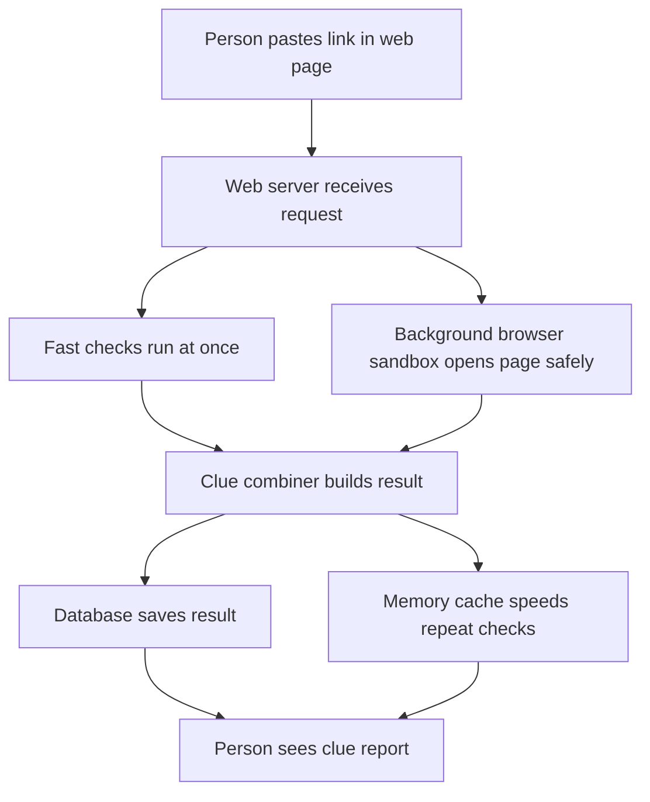
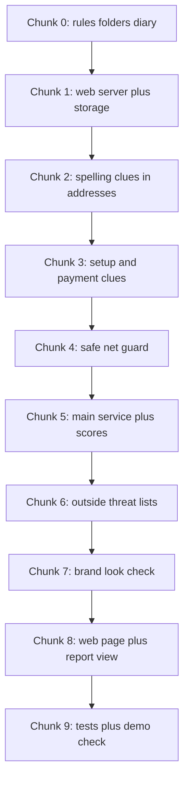

# TrueIntent Project Journal

## What is this file
This file is the living diary of the TrueIntent project. Each work chunk appends exactly one chapter. We write what we built, why we built it, and what really happened, including mistakes.

## How to read this journal
If you do not code, start here. Read the "In one minute" section of the latest chapter first. It gives the plain-words summary. Then read "How to explain this to a judge in 30 seconds". Skip the file lists unless you need detail. Technical terms are defined in "New terms" at the end of each chapter.

## Table of contents
- [Chapter 0: The big picture and setup](#chapter-0-the-big-picture-and-setup)
- Chapters 1 to 9: to be appended, one per chunk (placeholders, not written yet).

## Chapter 0: The big picture and setup
Date: 2026-10-16 | Commit message: chunk-0: repo rules, skeleton and journal
### 1. In one minute
We set up the empty house before building rooms. We wrote the rule book for coding helpers, created empty folders for the link checker, and started this diary. No checking of links works yet. That comes in later chunks.

### 2. Why we did this
Scam links trick people every day. A scam link is a web address that pretends to be a trusted shop or bank but steals money or passwords. A UPI deep link is a special link that opens a payment app in India and can ask you to send money. A QR code is a square barcode that phones can scan to open a link or start a payment. People fall for these because the fake page looks real and the message creates hurry or fear. Without clear rules and folders, later work gets messy and unsafe. So we fixed the rules and layout first.

### 3. How it works
Module A takes one input and reports clues. An indicator is a single clue like "this address uses numbers instead of a name". A verdict is a final judgment like "this is fraud". Module A only reports indicators, never verdicts, because only a full picture across many tools can judge fairly.

The three pillars are three angles of looking. Technical URL analysis means studying the spelling and setup of the address itself. Visual brand analysis means checking if the page copies a famous brand's look. Transaction context analysis means checking payment details like who receives the money.

Caption: Notice the request splits into fast checks and a separate safe browser, then merges into one report.

Build plan in short steps:

Caption: Notice each chunk adds one layer, in order, with nothing skipped.

In plain words: a person pastes a link. A web server is a program that answers web requests, like a reception desk. Fast checks study the text of the address. A separate browser sandbox is a locked room where a robot browser opens the page far from our main system. A database is a filing cabinet that keeps results. A memory cache is a sticky note on the desk for fast repeat answers. The combiner collects all clues into one report with plain explanations.

### 4. Decisions and reasoning
| decision | options considered | why we chose this | trade-off |
|---|---|---|---|
| FastAPI as web server | FastAPI, Flask, Django | FastAPI is a modern Python tool for building web servers, like a fast reception desk with built-in forms. It handles checks at once well. | Team must learn its style. |
| Celery plus Redis for background jobs | Celery plus Redis, plain threads | Celery is a task queue that runs slow jobs later, like a kitchen ticket line. Redis is a fast memory store used as the ticket board and sticky-note cache. Needed for slow browser work. | Two extra services to run. |
| Playwright for brand check | Playwright, plain download | Playwright is a tool that drives a real browser by remote control, like a robot visitor. Needed to see fake brand pages. | Heavy and slow, so it runs in background only. |
| PostgreSQL for storage | PostgreSQL, SQLite, files | PostgreSQL is a strong filing-cabinet database, like a bank vault for records. Needed for many reports. | Needs a server, not just a file. |
| Next.js for web page | Next.js, plain HTML | Next.js is a tool for building web pages with TypeScript, like a kit for fast modern pages. Good for paste-and-report views. | JavaScript complexity. |
| Empty skeleton now, code later | Full files now, empty folders now | Empty folders keep later chunks clean and avoid guessing code. | Nothing runs yet. |

### 5. What we built
- AGENTS.md: rule book for coding helpers at repo root.
- .gitignore: list of files Git must ignore, like keys and raw data.
- link-security-analyzer/backend/app/: empty Python packages with __init__.py files.
- link-security-analyzer/backend/tests, scripts, data, alembic: empty folders with .gitkeep markers.
- link-security-analyzer/frontend/src/app, components, lib: empty folders with .gitkeep markers.
- link-security-analyzer/eval/: empty folder with .gitkeep marker.
- docs/PROJECT_JOURNAL.md: this diary file with Chapter 0.
- README.md: short project intro with a link to the journal.

### 6. What actually happened
We cloned https://github.com/Kabira2006/TrueIntent.git into C:/Users/Dell/OneDrive/Desktop/AI CP/project/TrueIntent. Before the clone the project folder was empty with 0 entries. The parent folder resolved to a different repo with remote https://github.com/ShubhamBadadale/Spotify-Clone.git on branch featureEngineering, so we stopped, asked, and the user told us to clone into the project folder. After cloning, the TrueIntent repo was on branch main with a clean tree and remote origin https://github.com/Kabira2006/TrueIntent.git. Git log showed 4 commits with the latest dddee98 Delete prompt2.md. The repo held only 2 tracked files: prompts.md with 40 lines and URL_Prompts.md with 295 lines. There was no README.md, no LICENSE, no .gitignore, no application code, and no folders. Because there was no application code, we kept both prompt files untouched and only added new files. We ran git pull --ff-only and got Already up to date. We created AGENTS.md fresh because none existed, so no merge was needed. We created .gitignore fresh because none existed. We created 13 directories and 6 empty __init__.py files plus 8 .gitkeep files. We ran python -m pytest --collect-only and got no tests collected in 0.02s, exit code 5, which is expected with 0 tests. We ran python -m pytest -q and got no tests ran in 0.02s, exit code 5, with zero failures. We installed ruff 0.17.1 and ran python -m ruff check . and got All checks passed with exit code 0. Local Python was 3.10.9 while the stack asks for 3.11 plus, noted as a gap. No secrets were added. We also created README.md because none existed.

### 7. Limits and honest weaknesses
- Nothing checks links yet. The folders are empty.
- Ruff passes on empty files, but there is no real code to lint yet.
- Local Python 3.10.9 is older than the required 3.11 plus. Later chunks need 3.11 plus. Not verified in Docker yet.
- The two existing prompt files were not reviewed for content. We left them alone.
- No integration with other modules exists yet.

### 8. How to explain this to a judge in 30 seconds
People lose money to fake links and payment codes that look real. We are building a checker that shows clear clues instead of a simple yes or no. Today we set the rules, the empty layout, and this diary, so the next nine steps can build safely.

### 9. New terms
- URL: the text address of a web page, like a street address for the internet.
- UPI: Unified Payments Interface, India's instant payment system that lets apps send money by link.
- QR code: a square barcode a phone camera can read to open a link or payment.
- Indicator: a single clue about risk, like a wet road sign, not a final judgment.
- Verdict: a final guilty or innocent judgment, which this module never gives.
- FastAPI: a Python tool for building web servers quickly, like a fast reception desk.
- Celery: a Python tool that runs slow jobs in the background, like a kitchen ticket line.
- Redis: a very fast memory store used as a ticket board and short-term cache, like sticky notes.
- Playwright: a tool that controls a real browser by code, like a robot visitor.
- Browser sandbox: an isolated locked room where risky pages are opened safely.
- PostgreSQL: a strong database program that stores records safely, like a bank vault.
- Next.js: a tool for building modern web pages, like a kit for fast sites.
- Signal vector: a flat list of numbers that sums up the clues for other programs to use.
