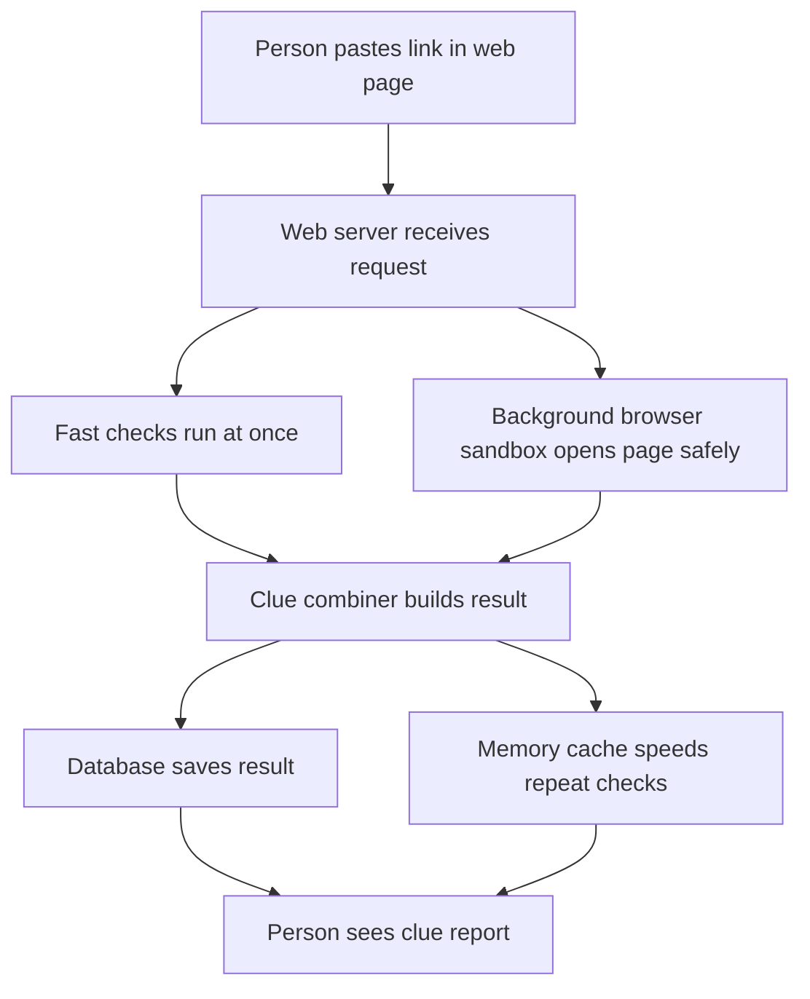
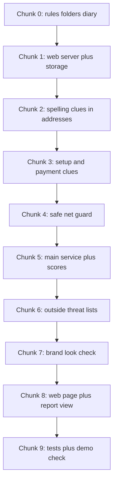
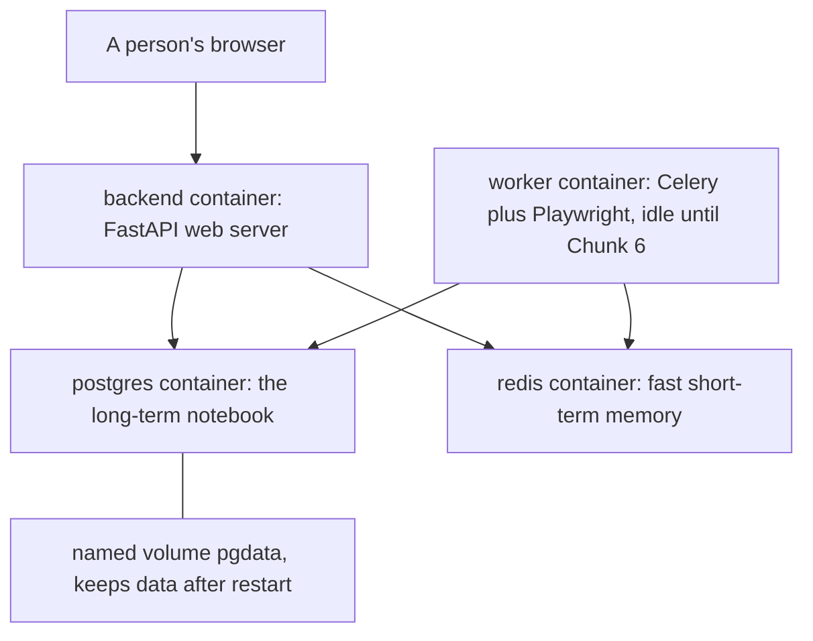
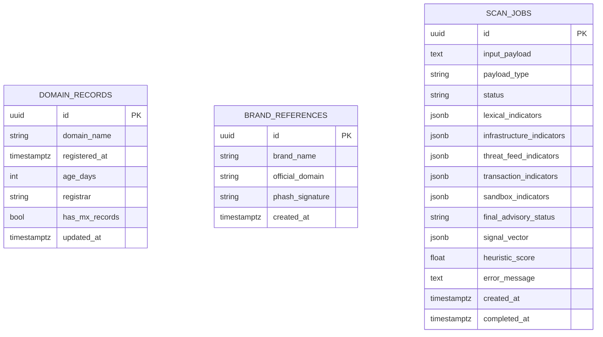

# TrueIntent Project Journal

## What is this file
This file is the living diary of the TrueIntent project. Each work chunk appends exactly one chapter. We write what we built, why we built it, and what really happened, including mistakes.

## How to read this journal
If you do not code, start here. Read the "In one minute" section of the latest chapter first. It gives the plain-words summary. Then read "How to explain this to a judge in 30 seconds". Skip the file lists unless you need detail. Technical terms are defined in "New terms" at the end of each chapter.

## Table of contents
- [Chapter 0: The big picture and setup](#chapter-0-the-big-picture-and-setup)
- [Chapter 1: Infrastructure, config and database](#chapter-1-infrastructure-config-and-database)
- Chapters 2 to 9: to be appended, one per chunk (placeholders, not written yet).

## Chapter 0: The big picture and setup
Date: 2026-10-16 | Commit message: chunk-0: repo rules, skeleton and journal
### 1. In one minute
We set up the empty house before building rooms. We wrote the rule book for coding helpers, created empty folders for the link checker, and started this diary. No checking of links works yet. That comes in later chunks.

### 2. Why we did this
Scam links trick people every day. A scam link is a web address that pretends to be a trusted shop or bank but steals money or passwords. A UPI deep link is a special link that opens a payment app in India and can ask you to send money. A QR code is a square barcode that phones can scan to open a link or start a payment. People fall for these because the fake page looks real and the message creates hurry or fear. Without clear rules and folders, later work gets messy and unsafe. So we fixed the rules and layout first.

### 3. How it works
Module A takes one input and reports clues. An indicator is a single clue like "this address uses numbers instead of a name". A verdict is a final judgment like "this is fraud". Module A only reports indicators, never verdicts, because only a full picture across many tools can judge fairly.

The three pillars are three angles of looking. Technical URL analysis means studying the spelling and setup of the address itself. Visual brand analysis means checking if the page copies a famous brand's look. Transaction context analysis means checking payment details like who receives the money.

Caption: Notice the request splits into fast checks and a separate safe browser, then merges into one report.

Build plan in short steps:

Caption: Notice each chunk adds one layer, in order, with nothing skipped.

In plain words: a person pastes a link. A web server is a program that answers web requests, like a reception desk. Fast checks study the text of the address. A separate browser sandbox is a locked room where a robot browser opens the page far from our main system. A database is a filing cabinet that keeps results. A memory cache is a sticky note on the desk for fast repeat answers. The combiner collects all clues into one report with plain explanations.

### 4. Decisions and reasoning
| decision | options considered | why we chose this | trade-off |
|---|---|---|---|
| FastAPI as web server | FastAPI, Flask, Django | FastAPI is a modern Python tool for building web servers, like a fast reception desk with built-in forms. It handles checks at once well. | Team must learn its style. |
| Celery plus Redis for background jobs | Celery plus Redis, plain threads | Celery is a task queue that runs slow jobs later, like a kitchen ticket line. Redis is a fast memory store used as the ticket board and sticky-note cache. Needed for slow browser work. | Two extra services to run. |
| Playwright for brand check | Playwright, plain download | Playwright is a tool that drives a real browser by remote control, like a robot visitor. Needed to see fake brand pages. | Heavy and slow, so it runs in background only. |
| PostgreSQL for storage | PostgreSQL, SQLite, files | PostgreSQL is a strong filing-cabinet database, like a bank vault for records. Needed for many reports. | Needs a server, not just a file. |
| Next.js for web page | Next.js, plain HTML | Next.js is a tool for building web pages with TypeScript, like a kit for fast modern pages. Good for paste-and-report views. | JavaScript complexity. |
| Empty skeleton now, code later | Full files now, empty folders now | Empty folders keep later chunks clean and avoid guessing code. | Nothing runs yet. |

### 5. What we built
- AGENTS.md: rule book for coding helpers at repo root.
- .gitignore: list of files Git must ignore, like keys and raw data.
- link-security-analyzer/backend/app/: empty Python packages with __init__.py files.
- link-security-analyzer/backend/tests, scripts, data, alembic: empty folders with .gitkeep markers.
- link-security-analyzer/frontend/src/app, components, lib: empty folders with .gitkeep markers.
- link-security-analyzer/eval/: empty folder with .gitkeep marker.
- docs/PROJECT_JOURNAL.md: this diary file with Chapter 0.
- README.md: short project intro with a link to the journal.

### 6. What actually happened
We cloned https://github.com/Kabira2006/TrueIntent.git into C:/Users/Dell/OneDrive/Desktop/AI CP/project/TrueIntent. Before the clone the project folder was empty with 0 entries. The parent folder resolved to a different repo with remote https://github.com/ShubhamBadadale/Spotify-Clone.git on branch featureEngineering, so we stopped, asked, and the user told us to clone into the project folder. After cloning, the TrueIntent repo was on branch main with a clean tree and remote origin https://github.com/Kabira2006/TrueIntent.git. Git log showed 4 commits with the latest dddee98 Delete prompt2.md. The repo held only 2 tracked files: prompts.md with 40 lines and URL_Prompts.md with 295 lines. There was no README.md, no LICENSE, no .gitignore, no application code, and no folders. Because there was no application code, we kept both prompt files untouched and only added new files. We ran git pull --ff-only and got Already up to date. We created AGENTS.md fresh because none existed, so no merge was needed. We created .gitignore fresh because none existed. We created 13 directories and 6 empty __init__.py files plus 8 .gitkeep files. We ran python -m pytest --collect-only and got no tests collected in 0.02s, exit code 5, which is expected with 0 tests. We ran python -m pytest -q and got no tests ran in 0.02s, exit code 5, with zero failures. We installed ruff 0.17.1 and ran python -m ruff check . and got All checks passed with exit code 0. Local Python was 3.10.9 while the stack asks for 3.11 plus, noted as a gap. No secrets were added. We also created README.md because none existed.

### 7. Limits and honest weaknesses
- Nothing checks links yet. The folders are empty.
- Ruff passes on empty files, but there is no real code to lint yet.
- Local Python 3.10.9 is older than the required 3.11 plus. Later chunks need 3.11 plus. Not verified in Docker yet.
- The two existing prompt files were not reviewed for content. We left them alone.
- No integration with other modules exists yet.

### 8. How to explain this to a judge in 30 seconds
People lose money to fake links and payment codes that look real. We are building a checker that shows clear clues instead of a simple yes or no. Today we set the rules, the empty layout, and this diary, so the next nine steps can build safely.

### 9. New terms
- URL: the text address of a web page, like a street address for the internet.
- UPI: Unified Payments Interface, India's instant payment system that lets apps send money by link.
- QR code: a square barcode a phone camera can read to open a link or payment.
- Indicator: a single clue about risk, like a wet road sign, not a final judgment.
- Verdict: a final guilty or innocent judgment, which this module never gives.
- FastAPI: a Python tool for building web servers quickly, like a fast reception desk.
- Celery: a Python tool that runs slow jobs in the background, like a kitchen ticket line.
- Redis: a very fast memory store used as a ticket board and short-term cache, like sticky notes.
- Playwright: a tool that controls a real browser by code, like a robot visitor.
- Browser sandbox: an isolated locked room where risky pages are opened safely.
- PostgreSQL: a strong database program that stores records safely, like a bank vault.
- Next.js: a tool for building modern web pages, like a kit for fast sites.
- Signal vector: a flat list of numbers that sums up the clues for other programs to use.

## Chapter 1: Infrastructure, config and database
Date: 2026-10-17 | Commit message: chunk-1: infrastructure, config and database
### 1. In one minute
We built the engine room. Five small computers-in-a-box (containers) now start with one command: a database, a fast memory, the web server, a background worker, and a placeholder for the future web page. The web server answers a health question that proves the database and the fast memory are reachable. Nothing checks links yet, but the ground is ready.

### 2. Why we did this
Before any link can be analysed we need somewhere to keep results, something fast to remember recent answers, and a clean way to start every part on any machine. Without this, later chunks would each invent their own database connections and settings, and secrets could leak into code. We also need one shared shape for saved jobs so the web server and the background worker can read the same records.

### 3. How it works
Docker is a tool that packs a program plus everything it needs into a sealed box called a container, like a shipping container that carries its own contents and never mixes with others on the ship. One file, `docker-compose.yml`, describes all the boxes and wires them together into a private network.

Caption: Notice the browser only ever talks to the web server, and both the web server and the worker share the same two storage boxes.

Each box has one job. Postgres is the long-term notebook: it holds every saved record on a disk that survives restarts (the named volume `pgdata`). Redis is fast short-term memory: it is a place to hand tasks to the worker and to remember recent answers for a few minutes. The backend is the web server that people and other programs call. The worker is the heavy background helper that will drive a real browser later; today it is defined but idle. The frontend is a placeholder box, replaced by the real web page in Chunk 8.

The tables in the notebook look like index cards. A picture of the three tables:

Caption: Notice each table stands alone today with no links between them; `scan_jobs` is the big one that records everything about one submitted link.

Step by step, in plain words: a person (later) submits a link. The web server writes one row into `scan_jobs` with status PENDING. Fast checks fill the indicator columns. If a real browser is needed, a ticket goes to Redis and the worker picks it up. When done, the status becomes COMPLETED or FAILED, and the finished clues are read back to build a report. `domain_records` is a notebook page per domain so we do not re-ask the same questions twice. `brand_references` is a card file of real brands and their logo fingerprints for later comparison.

### 4. Decisions and reasoning
| decision | options considered | why we chose this | trade-off |
|---|---|---|---|
| Docker containers | install everything by hand | one command starts the same stack on any machine, like swapping shipping crates | needs Docker Desktop running |
| Settings in a .env file | hard-code values in Python | keys and addresses change per machine; a separate private file keeps code clean | the file must never be committed |
| Postgres for storage | SQLite file | shared by both web server and worker, strong and concurrent | heavier than a single file |
| Redis | none | needed both as the task queue and as a fast cache | one more service |
| Indicators as JSONB | separate columns or a new table per clue | clue lists change shape often; JSONB stores a flexible labelled list without a schema change | harder to index individual clues |
| Alembic migrations | create tables by hand | one repeatable command builds or upgrades the schema anywhere | one more tool to learn |
| Playwright pinned to 1.63.0 | keep 1.64.0 | the official worker image `v1.63.0-jammy` matches; no `v1.64.0` image exists yet | slightly older browser build |

### 5. What we built
- `docker-compose.yml`: postgres:16, redis:7, backend, worker (Playwright image, limits, non-root), frontend placeholder.
- `.env.example`: every setting name and a safe placeholder value.
- `backend/Dockerfile`: Python 3.11 image, non-root `appuser`, uvicorn with reload.
- `backend/Dockerfile.worker`: Playwright Python image `v1.63.0-jammy`, non-root `pwuser`, Celery command.
- `backend/requirements.txt`: 24 pinned packages, verified to install.
- `backend/app/config.py`: pydantic-settings `Settings` reading all settings from the environment.
- `backend/app/db/session.py`: async engine and session for FastAPI, sync engine and sessionmaker for the worker.
- `backend/app/db/models.py`: typed models DomainRecord, BrandReference, ScanJob.
- `backend/alembic.ini`, `backend/alembic/env.py`, `backend/alembic/script.py.mako`: migration tool setup.
- `backend/alembic/versions/0001_initial.py`: first migration creating the three tables.
- `backend/app/main.py`: FastAPI app, CORS from config, `GET /healthz`.
- `backend/pytest.ini`: test paths, asyncio mode, integration marker.
- `backend/tests/test_config.py`, `backend/tests/test_healthz.py`: the tests.

### 6. What actually happened
Docker Desktop was not running, so we started it and waited about 30 seconds for the daemon. `docker compose up -d --build postgres redis backend` finished with exit 0; the backend image took about 204 seconds to build. `docker compose ps` showed `trueintent-postgres-1` healthy, `trueintent-redis-1` healthy, and `trueintent-backend-1` healthy. `GET http://localhost:8000/healthz` returned HTTP 200 with body `{"status":"ok","database":true,"redis":true}`. Running `python -m alembic upgrade head` printed `Running upgrade -> 0001_initial` and exited 0; `alembic current` showed `0001_initial (head)`, and `alembic check` said `No new upgrade operations detected`, meaning the migration exactly matches the models. Inside Postgres, `\dt` listed `alembic_version`, `brand_references`, `domain_records`, `scan_jobs`, and `scan_jobs` reported 15 columns. `python -m pytest -q` reported `5 passed in 7.01s`; `python -m ruff check .` first found 5 import-order errors, we fixed them with `ruff check --fix`, and the recheck said `All checks passed`. Two surprises: first, the pip package `playwright==1.64.0` exists but there is no matching Docker image, so both were pinned to 1.63.0; second, the worker image builds and pulls fine but the container exits with `ModuleNotFoundError: No module named 'app.workers.celery_app'`, because that file is Chunk 6 work. We left the worker defined but knowingly idle.

### 7. Limits and honest weaknesses
- The worker does not run yet; its module arrives in Chunk 6. It will exit until then.
- The frontend is only a sleeping placeholder.
- No data is stored by any real analysis yet; the tables exist but nothing writes to them.
- `age_days` is a cached value; readers must recompute it from `registered_at`. We only added a helper property, not an enforced rule.
- No foreign keys link the tables yet, because no relationships are needed until analysis code exists.
- The whole stack was verified on Windows with Docker Desktop only; not verified on Linux or macOS.

### 8. How to explain this to a judge in 30 seconds
One command starts our private engine room: a notebook that remembers everything, a fast short-term memory, a web server, and a background helper for heavy browser work. The web server proved it can reach both storage boxes, and the notebook was built from a single repeatable recipe. This is the foundation the link checker will stand on.

### 9. New terms
- Docker: a tool that packs a program and its needs into a sealed box that runs the same anywhere.
- Container: one such sealed box.
- docker-compose: a file that describes several boxes and how they connect.
- Image: the frozen recipe a container is started from.
- Volume: a disk area that outlives a container, so data is not lost on restart.
- Postgres: a strong database program, our long-term notebook.
- Redis: a very fast memory store, our short-term memory and task queue.
- Migration: a versioned script that builds or upgrades database tables.
- Alembic: the tool that runs those scripts.
- JSONB: a Postgres column type that stores a flexible labelled list, like a drawer of index cards.
- .env file: a private settings file on one machine, never committed to Git.
- Health check: a small question the server answers to prove it and its dependencies are alive.
- CORS: rules that say which web pages may call the server.
- Playwright image: a ready-made box that already contains a real browser.