# TrueIntent Project Journal

## What is this file
This file is the living diary of the TrueIntent project. Each work chunk appends exactly one chapter. We write what we built, why we built it, and what really happened, including mistakes.

## How to read this journal
If you do not code, start here. Read the "In one minute" section of the latest chapter first. It gives the plain-words summary. Then read "How to explain this to a judge in 30 seconds". Skip the file lists unless you need detail. Technical terms are defined in "New terms" at the end of each chapter.

## Table of contents
- [Chapter 0: The big picture and setup](#chapter-0-the-big-picture-and-setup)
- [Chapter 1: Infrastructure, config and database](#chapter-1-infrastructure-config-and-database)
- [Chapter 3: Understanding what was pasted (input router and UPI links)](#chapter-3-understanding-what-was-pasted-input-router-and-upi-links)
- [Chapter 4: Safe network checks (netguard, domain age, threat feeds)](#chapter-4-safe-network-checks-netguard-domain-age-threat-feeds)
- [Chapter 5: Putting the checks together (report, score and API)](#chapter-5-putting-the-checks-together-report-score-and-api)
- [Chapter 6: The background browser sandbox](#chapter-6-the-background-browser-sandbox)
- [Chapter 7: Spotting look-alike pages (visual brand check)](#chapter-7-spotting-look-alike-pages-visual-brand-check)
- [Chapter 9: Does it actually work? (evaluation)](#chapter-9-does-it-actually-work-evaluation)
- [Chapter 10: Whole-system recap and demo guide](#chapter-10-whole-system-recap-and-demo-guide)
- Chapters 2 and 8: not yet appended.

## Chapter 0: The big picture and setup
Date: 2026-10-16 | Commit message: chunk-0: repo rules, skeleton and journal
### 1. In one minute
We set up the empty house before building rooms. We wrote the rule book for coding helpers, created empty folders for the link checker, and started this diary. No checking of links works yet. That comes in later chunks.

### 2. Why we did this
Scam links trick people every day. A scam link is a web address that pretends to be a trusted shop or bank but steals money or passwords. A UPI deep link is a special link that opens a payment app in India and can ask you to send money. A QR code is a square barcode that phones can scan to open a link or start a payment. People fall for these because the fake page looks real and the message creates hurry or fear. Without clear rules and folders, later work gets messy and unsafe. So we fixed the rules and layout first.

### 3. How it works
Module A takes one input and reports clues. An indicator is a single clue like "this address uses numbers instead of a name". A verdict is a final judgment like "this is fraud". Module A only reports indicators, never verdicts, because only a full picture across many tools can judge fairly.

The three pillars are three angles of looking. Technical URL analysis means studying the spelling and setup of the address itself. Visual brand analysis means checking if the page copies a famous brand's look. Transaction context analysis means checking payment details like who receives the money.

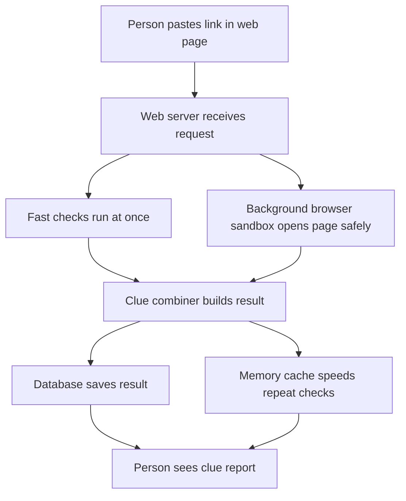

Caption: Notice the request splits into fast checks and a separate safe browser, then merges into one report.

Build plan in short steps:

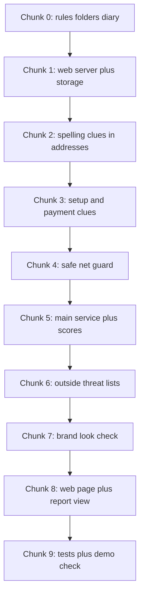

Caption: Notice each chunk adds one layer, in order, with nothing skipped.

In plain words: a person pastes a link. A web server is a program that answers web requests, like a reception desk. Fast checks study the text of the address. A separate browser sandbox is a locked room where a robot browser opens the page far from our main system. A database is a filing cabinet that keeps results. A memory cache is a sticky note on the desk for fast repeat answers. The combiner collects all clues into one report with plain explanations.

### 4. Decisions and reasoning
| decision | options considered | why we chose this | trade-off |
|---|---|---|---|
| FastAPI as web server | FastAPI, Flask, Django | FastAPI is a modern Python tool for building web servers, like a fast reception desk with built-in forms. It handles checks at once well. | Team must learn its style. |
| Celery plus Redis for background jobs | Celery plus Redis, plain threads | Celery is a task queue that runs slow jobs later, like a kitchen ticket line. Redis is a fast memory store used as the ticket board and sticky-note cache. Needed for slow browser work. | Two extra services to run. |
| Playwright for brand check | Playwright, plain download | Playwright is a tool that drives a real browser by remote control, like a robot visitor. Needed to see fake brand pages. | Heavy and slow, so it runs in background only. |
| PostgreSQL for storage | PostgreSQL, SQLite, files | PostgreSQL is a strong filing-cabinet database, like a bank vault for records. Needed for many reports. | Needs a server, not just a file. |
| Next.js for web page | Next.js, plain HTML | Next.js is a tool for building web pages with TypeScript, like a kit for fast modern pages. Good for paste-and-report views. | JavaScript complexity. |
| Empty skeleton now, code later | Full files now, empty folders now | Empty folders keep later chunks clean and avoid guessing code. | Nothing runs yet. |

### 5. What we built
- AGENTS.md: rule book for coding helpers at repo root.
- .gitignore: list of files Git must ignore, like keys and raw data.
- link-security-analyzer/backend/app/: empty Python packages with __init__.py files.
- link-security-analyzer/backend/tests, scripts, data, alembic: empty folders with .gitkeep markers.
- link-security-analyzer/frontend/src/app, components, lib: empty folders with .gitkeep markers.
- link-security-analyzer/eval/: empty folder with .gitkeep marker.
- docs/PROJECT_JOURNAL.md: this diary file with Chapter 0.
- README.md: short project intro with a link to the journal.

### 6. What actually happened
We cloned https://github.com/Kabira2006/TrueIntent.git into C:/Users/Dell/OneDrive/Desktop/AI CP/project/TrueIntent. Before the clone the project folder was empty with 0 entries. The parent folder resolved to a different repo with remote https://github.com/ShubhamBadadale/Spotify-Clone.git on branch featureEngineering, so we stopped, asked, and the user told us to clone into the project folder. After cloning, the TrueIntent repo was on branch main with a clean tree and remote origin https://github.com/Kabira2006/TrueIntent.git. Git log showed 4 commits with the latest dddee98 Delete prompt2.md. The repo held only 2 tracked files: prompts.md with 40 lines and URL_Prompts.md with 295 lines. There was no README.md, no LICENSE, no .gitignore, no application code, and no folders. Because there was no application code, we kept both prompt files untouched and only added new files. We ran git pull --ff-only and got Already up to date. We created AGENTS.md fresh because none existed, so no merge was needed. We created .gitignore fresh because none existed. We created 13 directories and 6 empty __init__.py files plus 8 .gitkeep files. We ran python -m pytest --collect-only and got no tests collected in 0.02s, exit code 5, which is expected with 0 tests. We ran python -m pytest -q and got no tests ran in 0.02s, exit code 5, with zero failures. We installed ruff 0.17.1 and ran python -m ruff check . and got All checks passed with exit code 0. Local Python was 3.10.9 while the stack asks for 3.11 plus, noted as a gap. No secrets were added. We also created README.md because none existed.

### 7. Limits and honest weaknesses
- Nothing checks links yet. The folders are empty.
- Ruff passes on empty files, but there is no real code to lint yet.
- Local Python 3.10.9 is older than the required 3.11 plus. Later chunks need 3.11 plus. Not verified in Docker yet.
- The two existing prompt files were not reviewed for content. We left them alone.
- No integration with other modules exists yet.

### 8. How to explain this to a judge in 30 seconds
People lose money to fake links and payment codes that look real. We are building a checker that shows clear clues instead of a simple yes or no. Today we set the rules, the empty layout, and this diary, so the next nine steps can build safely.

### 9. New terms
- URL: the text address of a web page, like a street address for the internet.
- UPI: Unified Payments Interface, India's instant payment system that lets apps send money by link.
- QR code: a square barcode a phone camera can read to open a link or payment.
- Indicator: a single clue about risk, like a wet road sign, not a final judgment.
- Verdict: a final guilty or innocent judgment, which this module never gives.
- FastAPI: a Python tool for building web servers quickly, like a fast reception desk.
- Celery: a Python tool that runs slow jobs in the background, like a kitchen ticket line.
- Redis: a very fast memory store used as a ticket board and short-term cache, like sticky notes.
- Playwright: a tool that controls a real browser by code, like a robot visitor.
- Browser sandbox: an isolated locked room where risky pages are opened safely.
- PostgreSQL: a strong database program that stores records safely, like a bank vault.
- Next.js: a tool for building modern web pages, like a kit for fast sites.
- Signal vector: a flat list of numbers that sums up the clues for other programs to use.

## Chapter 1: Infrastructure, config and database
Date: 2026-10-17 | Commit message: chunk-1: infrastructure, config and database
### 1. In one minute
We built the engine room. Five small computers-in-a-box (containers) now start with one command: a database, a fast memory, the web server, a background worker, and a placeholder for the future web page. The web server answers a health question that proves the database and the fast memory are reachable. Nothing checks links yet, but the ground is ready.

### 2. Why we did this
Before any link can be analysed we need somewhere to keep results, something fast to remember recent answers, and a clean way to start every part on any machine. Without this, later chunks would each invent their own database connections and settings, and secrets could leak into code. We also need one shared shape for saved jobs so the web server and the background worker can read the same records.

### 3. How it works
Docker is a tool that packs a program plus everything it needs into a sealed box called a container, like a shipping container that carries its own contents and never mixes with others on the ship. One file, `docker-compose.yml`, describes all the boxes and wires them together into a private network.

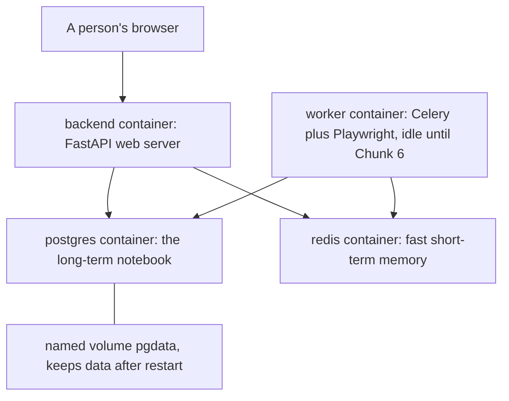

Caption: Notice the browser only ever talks to the web server, and both the web server and the worker share the same two storage boxes.

Each box has one job. Postgres is the long-term notebook: it holds every saved record on a disk that survives restarts (the named volume `pgdata`). Redis is fast short-term memory: it is a place to hand tasks to the worker and to remember recent answers for a few minutes. The backend is the web server that people and other programs call. The worker is the heavy background helper that will drive a real browser later; today it is defined but idle. The frontend is a placeholder box, replaced by the real web page in Chunk 8.

The tables in the notebook look like index cards. A picture of the three tables:

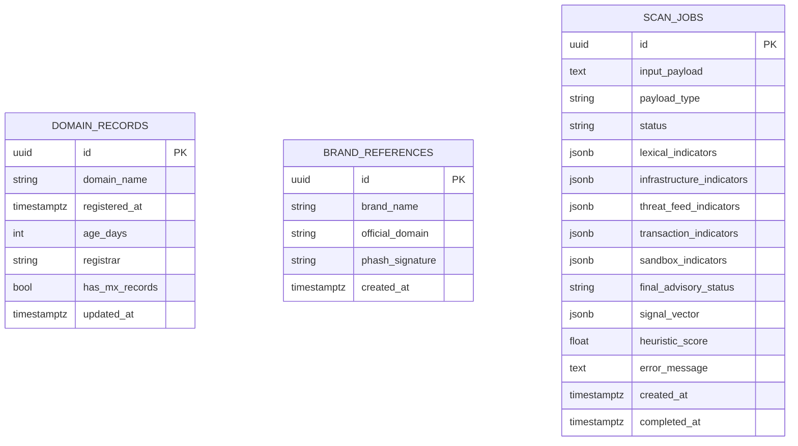

Caption: Notice each table stands alone today with no links between them; `scan_jobs` is the big one that records everything about one submitted link.

Step by step, in plain words: a person (later) submits a link. The web server writes one row into `scan_jobs` with status PENDING. Fast checks fill the indicator columns. If a real browser is needed, a ticket goes to Redis and the worker picks it up. When done, the status becomes COMPLETED or FAILED, and the finished clues are read back to build a report. `domain_records` is a notebook page per domain so we do not re-ask the same questions twice. `brand_references` is a card file of real brands and their logo fingerprints for later comparison.

### 4. Decisions and reasoning
| decision | options considered | why we chose this | trade-off |
|---|---|---|---|
| Docker containers | install everything by hand | one command starts the same stack on any machine, like swapping shipping crates | needs Docker Desktop running |
| Settings in a .env file | hard-code values in Python | keys and addresses change per machine; a separate private file keeps code clean | the file must never be committed |
| Postgres for storage | SQLite file | shared by both web server and worker, strong and concurrent | heavier than a single file |
| Redis | none | needed both as the task queue and as a fast cache | one more service |
| Indicators as JSONB | separate columns or a new table per clue | clue lists change shape often; JSONB stores a flexible labelled list without a schema change | harder to index individual clues |
| Alembic migrations | create tables by hand | one repeatable command builds or upgrades the schema anywhere | one more tool to learn |
| Playwright pinned to 1.63.0 | keep 1.64.0 | the official worker image `v1.63.0-jammy` matches; no `v1.64.0` image exists yet | slightly older browser build |

### 5. What we built
- `docker-compose.yml`: postgres:16, redis:7, backend, worker (Playwright image, limits, non-root), frontend placeholder.
- `.env.example`: every setting name and a safe placeholder value.
- `backend/Dockerfile`: Python 3.11 image, non-root `appuser`, uvicorn with reload.
- `backend/Dockerfile.worker`: Playwright Python image `v1.63.0-jammy`, non-root `pwuser`, Celery command.
- `backend/requirements.txt`: 24 pinned packages, verified to install.
- `backend/app/config.py`: pydantic-settings `Settings` reading all settings from the environment.
- `backend/app/db/session.py`: async engine and session for FastAPI, sync engine and sessionmaker for the worker.
- `backend/app/db/models.py`: typed models DomainRecord, BrandReference, ScanJob.
- `backend/alembic.ini`, `backend/alembic/env.py`, `backend/alembic/script.py.mako`: migration tool setup.
- `backend/alembic/versions/0001_initial.py`: first migration creating the three tables.
- `backend/app/main.py`: FastAPI app, CORS from config, `GET /healthz`.
- `backend/pytest.ini`: test paths, asyncio mode, integration marker.
- `backend/tests/test_config.py`, `backend/tests/test_healthz.py`: the tests.

### 6. What actually happened
Docker Desktop was not running, so we started it and waited about 30 seconds for the daemon. `docker compose up -d --build postgres redis backend` finished with exit 0; the backend image took about 204 seconds to build. `docker compose ps` showed `trueintent-postgres-1` healthy, `trueintent-redis-1` healthy, and `trueintent-backend-1` healthy. `GET http://localhost:8000/healthz` returned HTTP 200 with body `{"status":"ok","database":true,"redis":true}`. Running `python -m alembic upgrade head` printed `Running upgrade -> 0001_initial` and exited 0; `alembic current` showed `0001_initial (head)`, and `alembic check` said `No new upgrade operations detected`, meaning the migration exactly matches the models. Inside Postgres, `\dt` listed `alembic_version`, `brand_references`, `domain_records`, `scan_jobs`, and `scan_jobs` reported 15 columns. `python -m pytest -q` reported `5 passed in 7.01s`; `python -m ruff check .` first found 5 import-order errors, we fixed them with `ruff check --fix`, and the recheck said `All checks passed`. Two surprises: first, the pip package `playwright==1.64.0` exists but there is no matching Docker image, so both were pinned to 1.63.0; second, the worker image builds and pulls fine but the container exits with `ModuleNotFoundError: No module named 'app.workers.celery_app'`, because that file is Chunk 6 work. We left the worker defined but knowingly idle.

### 7. Limits and honest weaknesses
- The worker does not run yet; its module arrives in Chunk 6. It will exit until then.
- The frontend is only a sleeping placeholder.
- No data is stored by any real analysis yet; the tables exist but nothing writes to them.
- `age_days` is a cached value; readers must recompute it from `registered_at`. We only added a helper property, not an enforced rule.
- No foreign keys link the tables yet, because no relationships are needed until analysis code exists.
- The whole stack was verified on Windows with Docker Desktop only; not verified on Linux or macOS.

### 8. How to explain this to a judge in 30 seconds
One command starts our private engine room: a notebook that remembers everything, a fast short-term memory, a web server, and a background helper for heavy browser work. The web server proved it can reach both storage boxes, and the notebook was built from a single repeatable recipe. This is the foundation the link checker will stand on.

### 9. New terms
- Docker: a tool that packs a program and its needs into a sealed box that runs the same anywhere.
- Container: one such sealed box.
- docker-compose: a file that describes several boxes and how they connect.
- Image: the frozen recipe a container is started from.
- Volume: a disk area that outlives a container, so data is not lost on restart.
- Postgres: a strong database program, our long-term notebook.
- Redis: a very fast memory store, our short-term memory and task queue.
- Migration: a versioned script that builds or upgrades database tables.
- Alembic: the tool that runs those scripts.
- JSONB: a Postgres column type that stores a flexible labelled list, like a drawer of index cards.
- .env file: a private settings file on one machine, never committed to Git.
- Health check: a small question the server answers to prove it and its dependencies are alive.
- CORS: rules that say which web pages may call the server.
- Playwright image: a ready-made box that already contains a real browser.

## Chapter 3: Understanding what was pasted (input router and UPI links)
Date: 2026-10-22 | Commit message: chunk-3: input router and UPI analysis
### 1. In one minute
We added a first step that identifies whether pasted text is a web address, a UPI payment link, or other text from a QR code. We also added a parser that reads UPI payment fields and reports clues about those fields. It does not open links or decide what a person intended to do.

### 2. Why we did this
Different pasted inputs need different checks. A web address can be inspected as a URL, while a UPI link contains payment details that need their own explanation. A QR code is just a way to store text for a phone to read; that text may be a web link, a payment link, or a plain message. Routing first prevents those different things from being mistaken for one another.

### 3. How it works
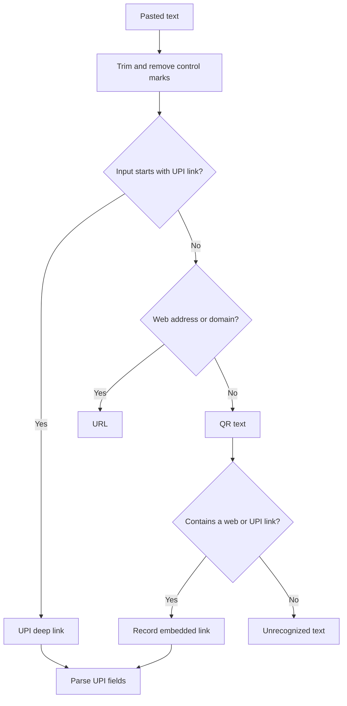
Caption: The router identifies the input shape first, then records a link found inside otherwise ordinary QR text.

A UPI payment link is a specially shaped address that can open a payment app with information already filled in. For example:

```text
upi://pay?pa=demo%40okhdfcbank&pn=Demo%20Shop&am=25.00&tr=order-7&tn=Book&cu=INR&mode=02&mc=5812
      |   |  |                    |                  |        |           |     |        |
      |   |  pa                   pn                 am       tr          tn    cu       mode, mc
      |   action
      scheme
```

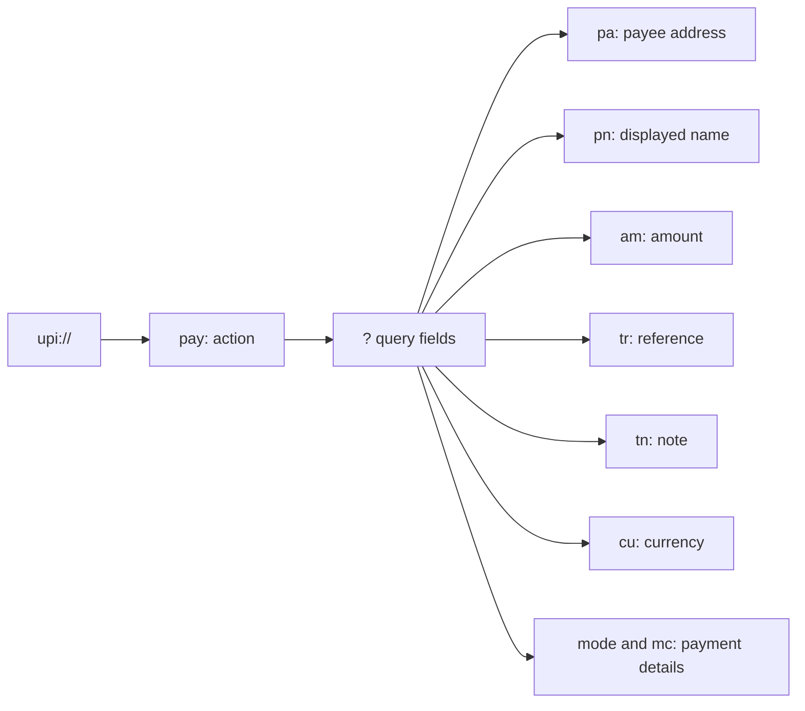
Caption: The left side selects the UPI action; the query after the question mark carries optional payment details.

The field names mean:

| Field | What it means |
|---|---|
| `pa` | Payee virtual payment address (VPA), the destination payment address. |
| `pn` | Payee name shown by the link. |
| `am` | Amount filled into the payment form. |
| `tr` | Transaction reference supplied by the link. |
| `tn` | Note or message attached to the payment. |
| `cu` | Currency code, such as INR for Indian rupees. |
| `mode` | Payment mode hint supplied by the link. |
| `mc` | Merchant category code supplied by the link. |

A `pay` link prepares a payment to a named destination. A `collect` link asks the person who opens it to approve a payment request; a `mandate` link also relates to a payment authorization. Scammers sometimes call a collect request a refund, hoping someone will approve money going out. The indicator therefore explains what the link asks for and says plainly: you never need a PIN to receive money.

A QR code is a printed or displayed pattern that encodes data, much like a label that a camera can read. The code itself does not prove what is behind it. This router handles the decoded text, finds a first web or UPI link when present, and leaves ordinary text recognizable as text.

The module reports facts written in the link. It cannot know whether the person expects to receive money, recognizes the payee, or meant to make a payment. That is the honest limit: link contents alone do not reveal the user's situation.

| Indicator code | Plain meaning | Example |
|---|---|---|
| `UPI_COLLECT_REQUEST` | The action is collect or mandate, which asks for payment approval. | `upi://collect?pa=demo@oksbi` |
| `INVALID_VPA_FORMAT` | The payee address does not match the expected shape. | `pa=not-a-vpa` |
| `UNKNOWN_PSP_HANDLE` | The address suffix is absent from the editable known-handle list; this is low severity only. | `pa=demo@samplehandle` |
| `PREFILLED_AMOUNT` | The link already contains an amount; configured thresholds raise its severity. | `am=10000` |
| `PAYEE_NAME_BRAND_MISMATCH` | A brand or authority word in the displayed name is absent from the payment address. | `pn=Refund%20Support&pa=person@ybl` |
| `MISSING_TRANSACTION_REF` | No transaction reference was supplied. | `upi://pay?pa=demo@oksbi` |
| `NON_INR_CURRENCY` | The link names a currency other than INR. | `cu=USD` |
| `SUSPICIOUS_NOTE_TEXT` | The note includes urgency, refund, or verification wording. | `tn=Urgent%20refund` |
| `UPI_EMBEDDED_IN_WEB_URL` | An HTTPS web address carries `pa` or `pn` query fields. | `https://example.com/pay?pa=demo%40oksbi` |
| `MALFORMED_UPI_URI` | The URI cannot be parsed as a supported UPI action. | `upi://unknown` |

The VPA examples use made-up `demo` or `person` names and example-style links; no live payment recipient is shown.

### 4. Decisions and reasoning
| decision | options considered | why we chose this | trade-off |
|---|---|---|---|
| Separate routing and UPI parsing | One function for every input, or two pure functions | Each function has one clear job and can be tested without network access. | Callers compose the two steps. |
| Pydantic models for results | Untyped dictionaries or shared typed models | One consistent indicator shape protects the contract used by later modules. | Callers must use the defined model fields. |
| Editable JSON lists and thresholds | Hard-code handles and amounts | Teammates can adjust the known handles, terminology, and severity thresholds without editing parser logic. | A bad configuration can affect classifications. |
| Treat absent facts as absent | Guess the user's intent or mark the link fraudulent | Link text cannot show the user's expectations or full context. | The report cannot make a final judgment. |

### 5. What we built
- `link-security-analyzer/backend/app/core/models.py`: shared typed indicator and result models.
- `link-security-analyzer/backend/app/core/input_router.py`: input cleanup, type classification, and embedded-link extraction.
- `link-security-analyzer/backend/app/core/upi.py`: URI and web-query parsing plus UPI indicators.
- `link-security-analyzer/backend/data/upi_handles.json`: editable PSP handles, terminology, and amount thresholds.
- `link-security-analyzer/backend/tests/test_input_router_upi.py`: table-driven pure unit tests.
- `docs/PROJECT_JOURNAL.md`: this chapter and its table-of-contents entry.

### 6. What actually happened
The backend test suite reported 42 passed in 5.28 seconds after the final code and formatting changes. The new test file covers 37 cases; the other 5 tests are from earlier chunks. Ruff passed repository-wide from the backend directory, and Ruff formatting reported all four changed Python files formatted.

An edge case that needed a correction was length checking: whitespace surrounding a short value should not cause rejection, so the router trims before applying the 2,048-character limit. Text containing only zero-width marks becomes empty and is rejected. Percent-encoded Unicode in the payee name decodes correctly. Invalid URI syntax returns an explicit malformed-link indicator instead of crashing. No network, database, or Redis calls are made by these modules or tests.

### 7. Limits and honest weaknesses
- The parser reports link contents only. It does not know whether a user expects to pay or receive money.
- The known handles and terminology are an editable list, not a live authoritative directory.
- A low-severity unknown handle may be new or legitimate; it is not a fraud verdict.
- Severity thresholds and wording are simple heuristics, not evidence of a scam.
- Python 3.11 was not available in this environment; tests ran using Python 3.10.9.
- The whole-repository Ruff check has existing import-order findings that were not changed in this chunk.

### 8. How to explain this to a judge in 30 seconds
Before checking a link, we identify what kind of text someone pasted. A UPI link can contain the recipient, amount, and payment note, so we explain those facts and flag patterns like a request to approve a payment. We do not guess the user's intent: the same link text cannot tell us whether they expected that payment.

### 9. New terms
- Router: a first sorting step that sends different input types to the right check.
- UPI: India's Unified Payments Interface, a system for sending money between payment apps and bank accounts.
- Deep link: a special address that opens a particular screen or action in an app.
- VPA: a virtual payment address, the text address used to identify a UPI payment destination.
- PSP handle: the provider name after `@` in a VPA, such as `oksbi`.
- Query field: a named value after `?` in a link, with fields separated by `&`.
- Percent encoding: a way to represent special characters in a URL, such as `%40` for `@`.
- QR code: a camera-readable pattern that stores text or other data.

## Chapter 4: Safe network checks (netguard, domain age, threat feeds)
Date: 2026-10-22 | Commit message: chunk-4: netguard, infrastructure checks and threat feeds
### 1. In one minute
We added a gate that checks a destination before our server looks it up or connects to it. We also added domain-registration and DNS clues, plus lookups against two existing threat lists. Tests use fake network services, so they check the decisions without contacting real servers.

### 2. Why we did this
Server-side request forgery (SSRF) is when someone tricks our server into visiting a place the public should not reach. Imagine a hostile link that tells our server to fetch a private cloud address, such as the machine's metadata service at `169.254.169.254`. The attacker may hope the server returns secrets or internal data. A browser user's computer and our analysis server are different visitors; this gate protects our server.

### 3. How it works
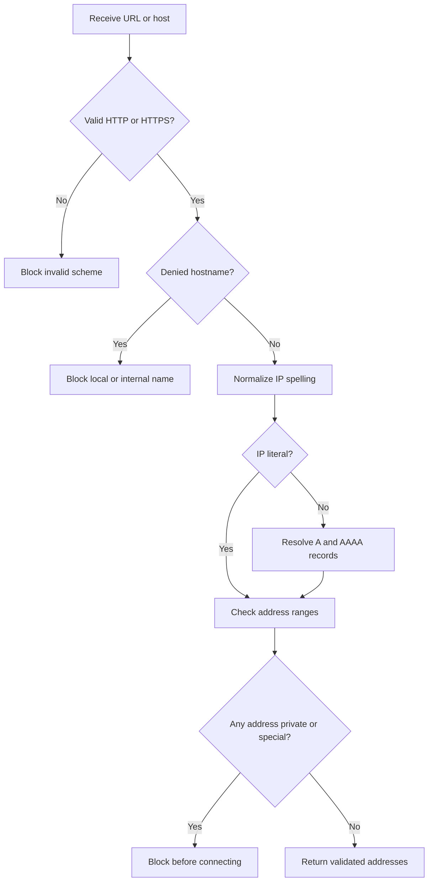
Caption: Every returned address is checked; one private or special address is enough to block the destination.

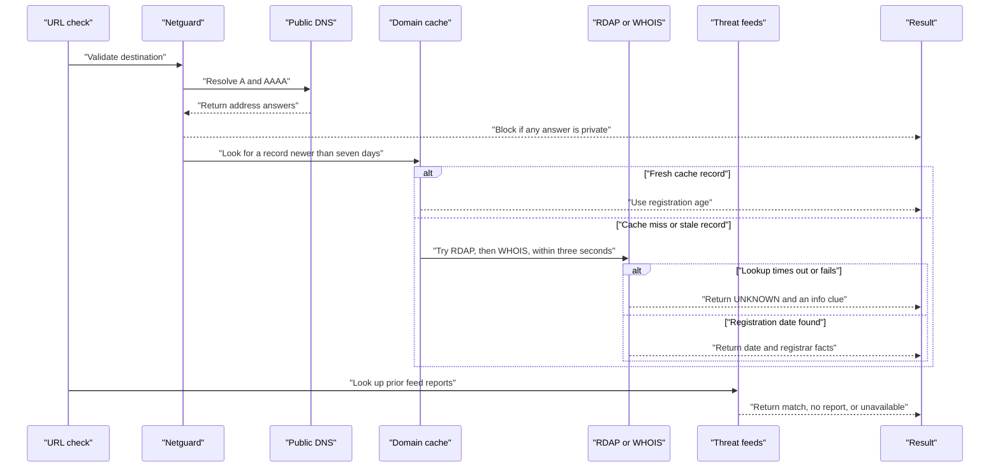
Caption: One destination is checked before its public data is queried, and a registry timeout becomes UNKNOWN instead of an invented age.

Netguard accepts web URLs and hostnames. A hostname is first resolved to its IPv4 and IPv6 addresses. It blocks the whole destination if any returned address is private, loopback, link-local, multicast, reserved, unspecified, carrier-grade shared space, or otherwise not globally routable. IPv4 addresses embedded in IPv6 addresses receive the same check. It also blocks `localhost`, names ending in `.local` or `.internal`, and configured service names such as `redis`, `postgres`, `backend`, and `worker`.

Some software accepts unusual spellings of an IP address. Netguard normalizes numeric decimal, hexadecimal, and traditional leading-zero octal IPv4 forms before deciding whether to allow them. For example, decimal `2130706433`, hex `0x7f000001`, and octal `0177.0.0.1` all describe the loopback address `127.0.0.1`, so all are blocked. The configurable list is `NETGUARD_DENYLIST` in `.env`.

| Blocked address type | Example range or address | Why it is blocked |
|---|---|---|
| Private IPv4 | `10.0.0.0/8`, `172.16.0.0/12`, `192.168.0.0/16` | These addresses are for private networks, not public destinations. |
| Loopback IPv4 and IPv6 | `127.0.0.0/8`, `::1/128` | These refer back to the same machine. |
| Link-local IPv4 and IPv6 | `169.254.0.0/16`, `fe80::/10` | These are local network addresses; cloud metadata commonly uses `169.254.169.254`. |
| Carrier-grade shared IPv4 | `100.64.0.0/10` | This is shared provider space, not a public service destination. |
| Multicast IPv4 and IPv6 | `224.0.0.0/4`, `ff00::/8` | These address groups of machines, not an ordinary public host. |
| Unspecified addresses | `0.0.0.0/32`, `::/128` | These do not identify a public destination. |
| Reserved or otherwise non-global ranges | Address classifications marked reserved or non-global | Special-purpose ranges are not treated as public targets. |
| IPv4-mapped IPv6 | `::ffff:127.0.0.1` | The embedded IPv4 address is checked too. |

A domain's age is a clue because some abusive domains are registered shortly before they are used, though a new domain can also be legitimate. RDAP and WHOIS are public domain-registration lookup systems, like checking a business registration record. The module checks the database's `domain_records` entry first and uses it only if its refresh time is within seven days. Otherwise it asks RDAP using the bundled Internet Assigned Numbers Authority (IANA) `dns.json` registry map, then falls back to the installed asyncwhois library. Registration under 7 days is high, under 30 is medium, and under 90 is low severity. A registrar name suggesting privacy or proxy service is an info-level clue only.

The registration lookup has a three-second overall deadline. The repository already set `WHOIS_TIMEOUT_SECONDS` to 3 seconds before this chunk; we retained that instead of a one-second draft because a one-second deadline can turn ordinary registry delay into UNKNOWN. We did not benchmark real registry response times. If a lookup fails, the result is UNKNOWN with an info clue—not a guessed age.

DNS checks request A (IPv4), AAAA (IPv6), MX (mail server), and NS (name server) records with the configured DNS timeout. Missing A and MX records are info clues; many real websites do not accept email and therefore have no MX record. Five or more A records with a minimum time-to-live of 60 seconds or less produce a low-severity fast-flux-like clue. That pattern is only a clue, not a conclusion.

Google Safe Browsing and VirusTotal are services that maintain reports about web addresses. Google Safe Browsing's `threatMatches:find` API requires the submitted URL in its request, so Google receives that URL during the check. VirusTotal is different here: we only use its GET endpoint to look up a previously existing report using the URL's base64url identifier; we never call its upload or scan endpoint. Both results are cached for 24 hours under a SHA-256 hash of the URL, rather than a plaintext URL cache key. VirusTotal lookups also use Redis counters capped at 4 per minute and 500 per day. Missing keys, exhausted limits, timeouts, or feed errors result in UNAVAILABLE, not a claim that the URL has or lacks a threat.

The guiding rule is: one failed check must never crash the scan. A failed database cache, registry, DNS query, or feed returns an explicit unknown or unavailable result where applicable. It does not get silently turned into a negative finding.

### 4. Decisions and reasoning
| decision | options considered | why we chose this | trade-off |
|---|---|---|---|
| Check both A and AAAA answers | Check one address family or both | A host must not pass when one family points inside a private network. | More DNS queries and a larger answer set to review. |
| Reject a target if any answer is non-public | Use only the first DNS answer | Prevents a mixed public/private answer from hiding an internal address. | A badly configured host with one private answer is blocked. |
| Normalize legacy numeric IP spellings | Parse only standard dotted IP text | Different URL handlers may interpret decimal, hex, and octal forms as IP literals. | Unusual numeric hostnames are rejected rather than looked up. |
| Return UNKNOWN on registry failure | Guess an age or treat failure as old | Missing data is not evidence about registration age. | Some reports have fewer clues when a registry is slow. |
| Use an existing VirusTotal report only | Submit the URL for a new scan | Avoids uploading the user's URL to VirusTotal. | A URL without an existing report remains unreported. |
| Keep threat results for 24 hours | Ask external services for every scan | Reduces repeated requests and helps respect provider limits. | A cached answer can be up to a day old. |

### 5. What we built
- `link-security-analyzer/backend/app/core/netguard.py`: typed target errors, URL and hostname validation, numeric-IP normalization, DNS resolution, and public-address screening.
- `link-security-analyzer/backend/app/core/infrastructure.py`: fresh database-cache lookup, RDAP/WHOIS domain age, registrar clue, and bounded DNS checks.
- `link-security-analyzer/backend/app/core/threat_feeds.py`: Google Safe Browsing and VirusTotal lookups, hashed cache keys, and Redis-based VirusTotal limits.
- `link-security-analyzer/backend/app/config.py` and `link-security-analyzer/.env.example`: denylist and threat-feed timeout settings.
- `link-security-analyzer/backend/data/dns.json`: official IANA RDAP DNS bootstrap data, publication date 2026-09-30.
- `link-security-analyzer/backend/tests/test_netguard.py`: blocked forms, private DNS answers, and public targets.
- `link-security-analyzer/backend/tests/test_infrastructure.py`: mocked database cache, RDAP, WHOIS, timeout, and DNS cases.
- `link-security-analyzer/backend/tests/test_threat_feeds.py`: mocked feed responses, API-key absence, cache, timeout, and rate-limit cases.
- `docs/PROJECT_JOURNAL.md`: this chapter and its table-of-contents entry.

### 6. What actually happened
The full backend test run reported 106 passed in 6.74 seconds. The three new Chunk 4 test files collected 64 cases. All tests replace DNS, HTTP, and Redis with fakes; no real network, database, or feed query was made. `python -m ruff check .` reported All checks passed for the backend. Ruff formatting passed for the new modules and tests.

The IANA bootstrap JSON parsed successfully and contains 592 RDAP service entries covering 1,203 top-level suffix entries. The most challenging edge cases were alternate numeric spellings of loopback addresses, IPv4-mapped IPv6, and a hostname whose A and AAAA answers contain a mix of public and private addresses. In each mixed-answer test, the private answer caused a block. DNS timeouts now fail closed in netguard, and partial DNS failures are marked unavailable rather than being reported as missing records. A domain string containing query syntax is rejected before any repository or registry lookup. Mocked timeout tests confirmed that registration becomes UNKNOWN and feed lookups become UNAVAILABLE. The first timeout test exposed that Python 3.10's asyncio timeout exception is distinct from the built-in `TimeoutError`; the catch was adjusted and the test now passes.

### 7. Limits and honest weaknesses
- DNS rebinding is not fully solved here. The guard checks and returns the addresses it saw, but a future caller that reconnects by hostname may trigger a second DNS lookup with different answers. A connection layer must pin the validated addresses and still verify the TLS hostname.
- Google Safe Browsing receives the submitted URL in its lookup request. VirusTotal is restricted to looking up existing reports and does not receive an upload request.
- External services and the PostgreSQL cache were mocked. Live RDAP, WHOIS, DNS, Redis, and provider behavior were not verified.
- WHOIS 3-second timeouts were tested with fakes; real registry timing was not measured.
- Optional TLS certificate checks were not implemented in this chunk.

### 8. How to explain this to a judge in 30 seconds
Before our server looks up a pasted address, we check that it does not point back into a private network. Then we collect domain-age, DNS, and existing threat-report clues. If any outside service fails, we say its result is unknown instead of guessing. We also avoid VirusTotal uploads and tell users that Google's lookup API does receive the URL.

### 9. New terms
- SSRF: a trick that makes a server visit a private address on an attacker's behalf.
- Netguard: the gate that checks a destination's address before a connection is made.
- A record: a DNS answer that maps a name to an IPv4 address.
- AAAA record: a DNS answer that maps a name to an IPv6 address.
- MX record: a DNS entry that names the server receiving email for a domain.
- NS record: a DNS entry that names servers responsible for a domain's DNS answers.
- TTL: time-to-live, the number of seconds a DNS answer may be reused before checking again.
- RDAP: a modern public service for looking up domain-registration records.
- WHOIS: an older public service for looking up domain-registration records.
- IANA: the organization that coordinates shared Internet registries, including RDAP service directions.
- Threat feed: a service that shares previously recorded reports about harmful links.
- Redis limiter: a shared counter that prevents a service from being queried more often than its allowed rate.
- DNS rebinding: a trick where a domain returns a public address during checking and a private address later.

## Chapter 5: Putting the checks together (report, score and API)
Date: 2026-10-23 | Commit message: chunk-5: aggregator, service layer and API
### 1. In one minute
We connected the existing checks to one library service and a small web API. The service sorts each input, runs checks together within a time budget, and turns their clues into three readable pillars. The API returns a quick summary first and lets the caller fetch the report by its scan ID. A future browser sandbox has a clearly marked enqueue hook, but this chunk does not implement that worker.

### 2. Why we did this
Separate checks are hard to read and use consistently. The aggregator gives each clue a stable shape and groups clues into three pillars: technical URL analysis (the spelling and setup of a web address), visual brand analysis (whether a page resembles a known brand), and transaction context analysis (payment details in a UPI link). A stable shape means other code can reliably find the same fields without guessing.

The report says “indicators detected,” “no indicators detected,” or “inconclusive.” It does not say “safe” or “fraud.” A missing clue is not proof that a link is harmless, and a warning can have an innocent explanation; confident-sounding labels could mislead someone into taking a harmful action.

### 3. How it works
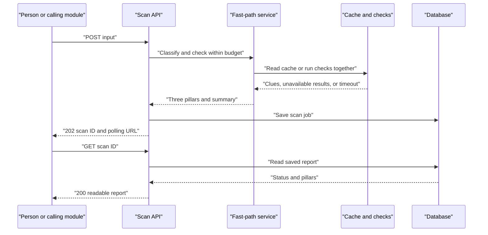
Caption: The first answer contains a scan ID; a later GET retrieves the saved pillar report.

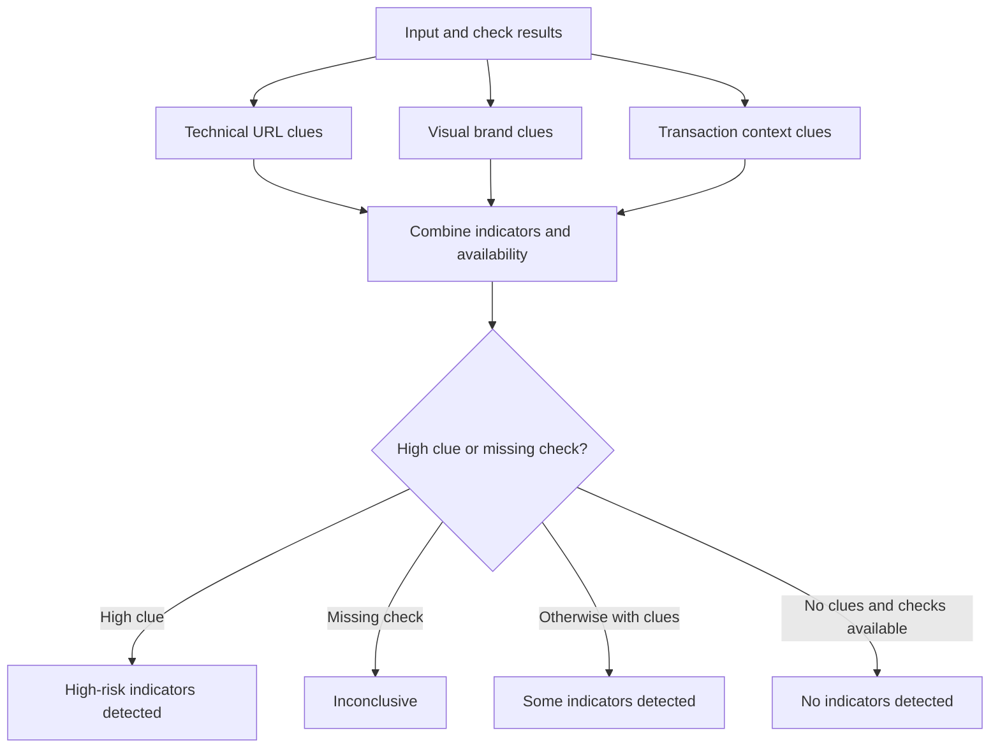
Caption: The overall wording depends on the clues and on whether the relevant checks actually completed.

The library entry point classifies the input, then starts relevant checks concurrently under a five-second default budget. If a check fails or is too slow, its pillar reports unavailable information instead of crashing the scan or inventing a result. Results are cached for one hour using a SHA-256 digest of the normalized input; a digest is a fixed-length fingerprint, not the input itself. Scan submission and report polling use separate Redis fixed-window limits, defaulting to 20 submissions and 120 report reads per minute per client address.

The three pillars contain indicators with four stable fields: `code` is a machine-readable name, `severity` is info/low/medium/high, `message` is a plain-language explanation, and `evidence` contains supporting facts. Pillar statuses are `NOT_APPLICABLE`, `NO_INDICATORS`, `FLAGGED`, `UNAVAILABLE`, or `PENDING`. The overall result is `NO_INDICATORS_DETECTED`, `SOME_INDICATORS_DETECTED`, `HIGH_RISK_INDICATORS_DETECTED`, or `INCONCLUSIVE`.

The flat `signal_vector` is a set of numeric and boolean facts for later combination, such as URL entropy, domain age, subdomain depth, feed matches, and UPI flags. The internal heuristic score is a weighted sum of indicator severities, capped at 1. It is explicitly **uncalibrated**: no measured dataset has shown that a score of, for example, 0.8 corresponds to an 80% chance of harm. It is not in the user-facing API and must never be shown as a probability or percentage. A later trained model may replace the heuristic and combine these features with the future text-scam engine; that model is not part of this chunk.

For web links, the API saves a `FAST_PATH_DONE` result when sandboxing is enabled and calls the Chunk 6 enqueue hook; otherwise it marks the job `COMPLETED`. The current hook only logs the scan ID. UPI-only and QR-text requests do not queue a browser job.

### 4. Decisions and reasoning
| decision | options considered | why we chose this | trade-off |
|---|---|---|---|
| Report clues, not verdicts | Say “safe/fraud” or report indicators | A few checks cannot know the full situation; cautious wording avoids false confidence. | Users must interpret clues in context. |
| Keep score internal | Show a percentage or keep an uncalibrated feature | There is no calibration data to make a percentage honest. | The user sees pillars and evidence, not a single score. |
| Deadline and failure degradation | Wait indefinitely or return partial results | One slow dependency must not hold up all checks; unavailable is more honest than guessing. | Some reports are inconclusive. |
| Return fast result, poll for later work | Hold the request open or split fast and background work | The browser sandbox is slow and belongs in a later worker chunk. | The visual pillar can remain pending. |
| Cache and fixed-window limits | Recompute every time or allow unlimited requests | A one-hour cache saves repeat work; per-client limits constrain request bursts. | Redis availability is required for limiting. |
| Missing lexical check | Invent URL clues or mark the check unavailable | `app.core.lexical` is not present in this repository yet, so no lexical findings are fabricated. | URL scans currently tend to be inconclusive. |

### 5. What we built
- `link-security-analyzer/backend/app/core/aggregator.py`: pillar statuses, overall indicator, signal vector, and internal weighted heuristic.
- `link-security-analyzer/backend/app/core/service.py`: library entry point, concurrent bounded checks, failure degradation, and one-hour result cache.
- `link-security-analyzer/backend/app/api/v1/schemas.py`: validated request, accepted response, summary, and polling response contracts.
- `link-security-analyzer/backend/app/api/v1/endpoints.py`: POST/GET routes, database persistence, per-client rate limits, and the sandbox hook.
- `link-security-analyzer/backend/app/main.py`: mounts the versioned API router.
- `link-security-analyzer/backend/app/core/threat_feeds.py`: wording adjustment to keep generated messages within advisory wording rules.
- `link-security-analyzer/backend/tests/test_aggregator.py`: pillar, score, vector, and forbidden-wording checks.
- `link-security-analyzer/backend/tests/test_service.py`: mocked service, cache, timeout, and check-failure cases.
- `link-security-analyzer/backend/tests/test_api.py`: mocked database/Redis API, validation, polling, and rate-limit cases.
- `docs/PROJECT_JOURNAL.md`: this chapter and its table-of-contents entry.

### 6. What actually happened
The backend-wide Ruff check reported “All checks passed.” The full pytest suite reported **128 passed in 4.78 seconds**; the three new Chunk 5 test files contain **22 tests**. The tests use fake checks, Redis, and database dependencies, so they do not make network calls.

A TestClient run of the real API routes with fake fast-path, database, and Redis dependencies returned POST **202** and polling GET **200**. The sample below is that run; `example[.]com` is defanged for this journal. The URL check itself was deliberately unavailable because the lexical analyzer module does not yet exist, and the visual pillar was pending because the sandbox worker is a later chunk.

POST response:
```json
{
  "scan_id": "6a4ab694-b1f1-43f1-9a73-726a647865dc",
  "status": "FAST_PATH_DONE",
  "fast_path_summary": {
    "payload_type": "URL",
    "domain": "example[.]com",
    "is_punycode": false,
    "shannon_entropy": 2.75,
    "domain_age_days": 200,
    "threat_feed_matches": 0
  },
  "poll_url": "http://testserver/api/v1/scan/6a4ab694-b1f1-43f1-9a73-726a647865dc"
}
```

Polling GET response:
```json
{
  "scan_id": "6a4ab694-b1f1-43f1-9a73-726a647865dc",
  "status": "FAST_PATH_DONE",
  "overall_indicator": "INCONCLUSIVE",
  "advisory_report": {
    "technical_url_analysis": {
      "status": "UNAVAILABLE",
      "indicators": [{
        "code": "CHECK_UNAVAILABLE",
        "severity": "info",
        "message": "URL spelling checks could not be completed.",
        "evidence": {"status": "UNAVAILABLE"}
      }]
    },
    "visual_brand_analysis": {"status": "PENDING", "indicators": []},
    "transaction_context_analysis": {
      "status": "NOT_APPLICABLE",
      "indicators": []
    }
  }
}
```

Reading guide: `scan_id` identifies the saved job; `status` says the fast path has finished but background work may remain; the summary reports the recognized input and available fast facts; `overall_indicator` is inconclusive because a relevant check is unavailable; each pillar shows its own status and evidence; `CHECK_UNAVAILABLE` explains why there is no URL spelling result. `example[.]com` is only a documentation placeholder, and the entropy/domain-age values were supplied by the test double, not measured from a live site.

A separate local Uvicorn/curl smoke test also returned **202** for POST and **200** for polling GET with the same report shape and fake dependencies. Docker Compose was **not verified**: Docker Desktop's Linux engine pipe was unavailable. This smoke test therefore verifies HTTP routing and response shape, not a live end-to-end deployment. The missing lexical module and sandbox worker are deviations from the requested fully connected result; neither is silently represented as a completed check.

### 7. Limits and honest weaknesses
- The `app.core.lexical` URL analyzer is absent, so URL spelling analysis returns unavailable; URL reports can therefore be inconclusive.
- The sandbox enqueue function is a logging hook only. No browser worker or visual-brand analysis was implemented.
- The API smoke run used mocked database, Redis, and checks. Docker-backed deployment and live provider calls were not verified.
- Redis failure prevents enforcing request limits and is reported as a service error; it is not treated as permission to bypass the limiter.
- The score has no statistical calibration and is not a probability.
- These indicators describe link contents and check availability, not the user's intent or circumstances.

### 8. How to explain this to a judge in 30 seconds
We give every scan the same three-part report format so people and later software can understand the clues consistently. The service runs quick checks together, saves the result, and provides a scan ID for polling. It uses cautious wording because clues are not proof. Its internal score is an uncalibrated engineering feature, not a probability shown to users. If an external check is slow or missing, the report says so rather than guessing.

### 9. New terms
- Pillar: one named group of related indicators in the report.
- Signal vector: a flat list of numeric facts prepared for later analysis.
- Uncalibrated heuristic: a rule-based score that has not been tested as a probability.
- Fast path: the set of quick checks used to return an early report.
- Polling: asking the API again later for a saved job's current result.
- Fixed-window rate limit: a cap on how many requests one client can make during a set time interval.
- SHA-256: a standard method that turns input text into a fixed-length fingerprint.
- TestClient: a local test tool that sends HTTP-like requests to the application without deploying it.

## Chapter 6: The background browser sandbox
Date: 2026-10-23 | Commit message: chunk-6: playwright sandbox worker
### 1. In one minute
We added a background browser worker to look at what a web page actually does after someone submits its address. A real browser can reveal redirects, hidden frames, and forms that ask for passwords or payment details. The worker checks every page request before allowing it, records findings, and throws away the browser context when the visit ends.

### 2. Why we did this
A link alone cannot show the page's final destination or what its forms ask a visitor to enter. Pages can redirect after opening, load hidden content, or show different elements to an ordinary browser than to a text-only check. The browser runs as a Celery task after the quick scan so that slow page loading does not hold the API request open.

A sandbox is like a disposable room with a locked door: one visit happens inside a fresh browser context, and that context is closed afterward. It reduces exposure, but it is not a perfect barrier against every browser or operating-system weakness.

### 3. How it works
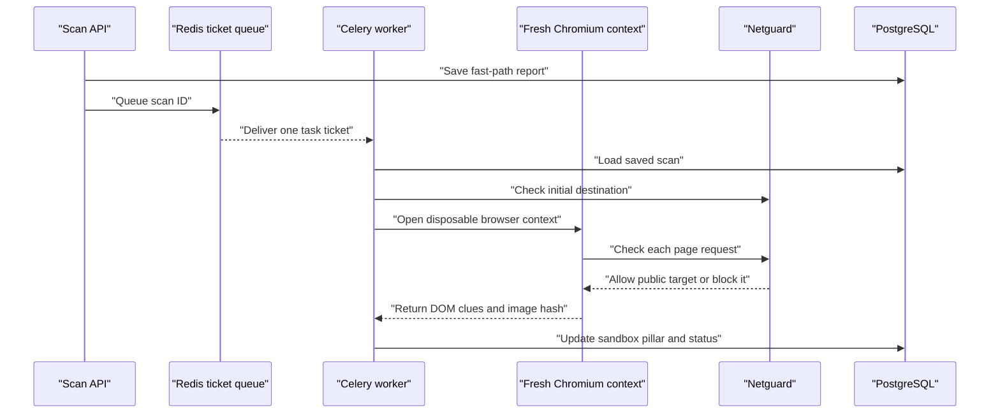
Caption: The API hands the scan ID to a queue; the worker performs browser work and updates the existing report.

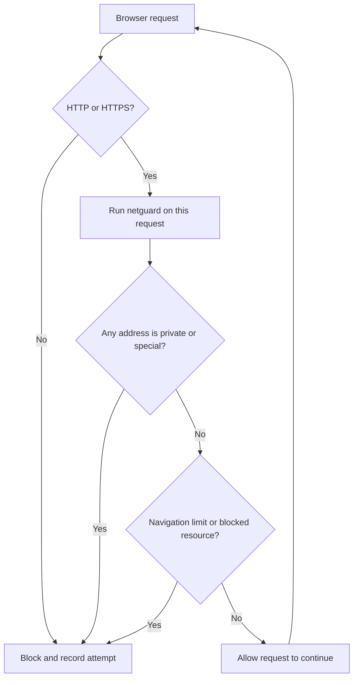
Caption: Redirects and subresources return through the same destination check; the browser does not get a one-time pass.

Celery is the background task runner. Redis is the message queue, a shared ticket rail. Think of the API as a restaurant waiter who writes an order ticket, Redis as the rail that holds it, and the Celery worker as the kitchen that prepares it. The API saves the fast report, places the scan ID on the rail, and returns. The worker later updates the saved report.

For each scan, the worker loads the existing database row and its fast-path domain-age clue. It validates the first URL with netguard, then starts headless Chromium with a new context. The context has a fixed viewport and user agent, no saved browser state, no granted permissions, blocked service workers, and downloads disabled. It dismisses page dialogs. Each HTTP or HTTPS request, including redirect and subresource requests, is checked again; non-web schemes, media, WebSockets, excessive navigations, and private or special addresses are blocked and recorded as indicators.

The worker records redirect hosts without query strings, audits the page's document structure for forms and hidden content, and checks whether a new domain presents a login-like form. It captures one 1280 by 720 screenshot in memory, calculates a perceptual hash (a compact fingerprint of visual appearance), discards the image bytes, and stores the hash with host-only navigation metadata. It then closes the browser context. If the check fails or times out, the job becomes `FAILED`, an error is recorded, and the already-saved fast-path pillars remain intact.

We deliberately do not save screenshots, accept downloads, or intentionally visit internal addresses. A local loopback exception exists only as a private test function argument that defaults off; no environment variable, API input, or Celery task can turn it on.

### 4. Decisions and reasoning
| decision | options considered | why we chose this | trade-off |
|---|---|---|---|
| Run browser work in Celery | Keep the API request open or queue a background task | A browser visit can take longer than fast checks; the API can return while the worker continues. | The report is initially pending. |
| Fresh context for every scan | Reuse a logged-in browser context or create and close one | Fresh state prevents cookies and storage from carrying between hostile pages. | Browser startup costs time and resources. |
| Recheck each request | Check only the first address or check redirects and page resources too | A page can redirect or request an internal address after its first load. | DNS rebinding between checking and connecting is still possible. |
| Keep image fingerprint, discard image | Store screenshot or compute an in-memory hash | A compact hash supports later comparisons without retaining page images. | A hash cannot show a reviewer what the page looked like. |
| Use Chromium sandbox and seccomp | Disable browser sandbox or enable browser and container layers | The worker runs as non-root, requests Chromium's sandbox, and uses Playwright's version-matched seccomp profile. | Linux container execution could not be checked because the Docker engine was unavailable. |
| Preserve fast results on failure | Replace the job with a failure or keep its earlier findings | A browser failure should not erase checks that already finished. | A failed job can still have an incomplete visual pillar. |

### 5. What we built
- `link-security-analyzer/backend/app/core/sandbox.py`: browser lifecycle, per-request netguard routing, redirect tracking, DOM audit, byte/navigation limits, and in-memory image hashing.
- `link-security-analyzer/backend/app/workers/celery_app.py`: Redis-backed Celery application with concurrency two, late acknowledgments, and task time limits.
- `link-security-analyzer/backend/app/workers/tasks.py`: sync database task that runs the async browser routine, recomputes the report, and preserves fast results on failure.
- `link-security-analyzer/backend/app/api/v1/endpoints.py`: dispatches the Celery task and reports queue errors explicitly.
- `link-security-analyzer/backend/app/config.py`: sandbox time, navigation, and byte-limit settings.
- `link-security-analyzer/backend/Dockerfile.worker`: starts the configured sandbox task consumer.
- `link-security-analyzer/backend/tests/test_sandbox.py`: mocked network-guard and DOM checks plus an explicitly opted-in local-server integration test.
- `link-security-analyzer/backend/tests/test_sandbox_task.py`: task success, failure, retention, and Celery configuration tests.
- `link-security-analyzer/backend/tests/test_api.py`: Celery dispatch and queue-failure API tests.
- `link-security-analyzer/backend/tests/fixtures/sandbox_login.html`: local static page used by DOM audit tests.
- `link-security-analyzer/backend/seccomp_profile.json`: Playwright 1.63.0 seccomp profile.
- `link-security-analyzer/docker-compose.yml`: non-root worker settings, resource limits, temporary filesystem, Chromium seccomp profile, and worker health check.
- `link-security-analyzer/.env.example`: documented sandbox limit settings.
- `link-security-analyzer/README.md`: sandbox threat model and production egress guidance.
- `docs/PROJECT_JOURNAL.md`: this chapter and table-of-contents entry.

### 6. What actually happened
The final complete backend run reported **145 passed in 12.35 seconds**, including the one local Playwright integration test. Pytest also emitted one `RuntimeWarning` from the existing Chunk 5 `service.py` cache-write timeout test: coroutine `_write_cache` was never awaited. That unrelated warning is recorded rather than changed in this chunk. The integration server exercised two HTTP redirects and a cross-host form. The test's explicit loopback exception was enabled only by passing a private function argument; it is off by default and is not configurable through the environment. Ruff reported **All checks passed**, and all eight changed Python files passed the formatting check. Docker Compose configuration syntax also validated.

The pinned Playwright Chromium browser was installed locally and the browser integration test passed. Chromium is launched with its sandbox enabled (`chromium_sandbox=True`); no `--no-sandbox` override was used. This is the actual local test result, not proof that Linux Docker will start the sandbox with the host's kernel settings.

Docker Compose could not be run: Docker Desktop's Linux engine pipe was missing. The profile JSON and Compose configuration were validated, but container startup, non-root Chromium sandbox operation, memory limits, and egress behavior are **not verified**. One first unit-test attempt failed because its fake media request was accidentally marked as a navigation; the fake was corrected, and the final suite passed. A whole-repository formatting check also pointed to the existing `backend/alembic/env.py`; it was left unchanged because it is outside this chunk.

### 7. Limits and honest weaknesses
| threat | what we did | residual risk |
|---|---|---|
| DNS rebinding between validation and connection | Check the starting URL and every intercepted request with netguard. | DNS may change after validation but before Chromium connects; this race is not fully solved. |
| Worker reaches private services | Block private, loopback, link-local, multicast, reserved, and other non-public targets; block local service names. | The worker still shares a Docker network with Redis and PostgreSQL. Production should use network isolation and an outbound firewall rule denying internal ranges. |
| Browser escape | Use a non-root account, Chromium's sandbox, and the version-matched seccomp profile. Do not pass `--no-sandbox`. | The Linux container's Chromium sandbox was not runtime-verified here; host kernel and Docker settings affect it. Browser vulnerabilities remain possible. |
| Excessive or persistent page activity | Limit the browser task time, page timeout, navigations, and observed network bytes; disable downloads, media, sockets, and service workers. | A browser bug, a short in-flight transfer, or a network mechanism outside routed HTTP requests can bypass these limits; production egress filtering remains necessary. |
| Retention of page images | Hash an in-memory screenshot and discard the image. | The worker temporarily processes page content and image bytes in memory. |

### 8. How to explain this to a judge in 30 seconds
Some clues appear only after a page opens, so a quick text check cannot find them all. We put each visit in a fresh, disposable browser room. A background worker checks every request before it leaves the room, looks for redirects and sensitive forms, keeps a small visual fingerprint, and throws the room away. If the browser fails, the earlier fast report stays saved. DNS rebinding and the worker's shared Docker network remain honest risks that need production network controls.

### 9. New terms
- Playwright: a tool that controls a real browser from code.
- Celery: a task runner that performs work outside the web request.
- Message queue: a shared line of task tickets waiting for a worker.
- DOM: the browser's structured representation of a page, including forms and frames.
- Seccomp: a Linux filter that limits which system calls a process can make.
- Perceptual hash: a short visual fingerprint that can help compare images without retaining the image.
- DNS rebinding: a trick where a domain changes its address after it passes an initial check.

## Chapter 7: Spotting look-alike pages (visual brand check)
Date: 2026-10-24 | Commit message: chunk-7: brand fingerprints and visual matching
### 1. In one minute
We added a supporting check for pages that look like a known brand while using a different web address. The browser takes a screenshot in memory, turns it into a short visual fingerprint, and compares that fingerprint with references for official brands. A close match becomes an indicator, not a verdict. The screenshot itself is discarded.

### 2. Why we did this
A copycat page can use a bank or shop's colors and layout while its address belongs to someone else. Address spelling checks cannot see a page's appearance. A visual comparison adds one more clue, while the official-domain list helps prevent a real brand page from being flagged as an impersonator.

### 3. How it works
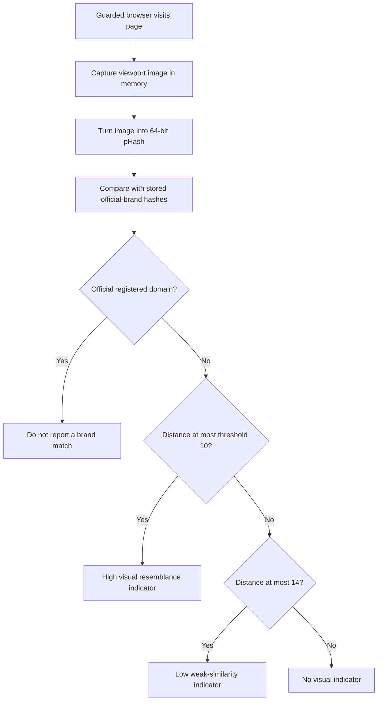
Caption: The page image is reduced to a fingerprint, and only close matches on non-official domains become indicators.

A **perceptual hash** (pHash) is a compact visual fingerprint: it reduces an image to a tiny light-and-dark pattern that can stay similar when the image changes a little. **Hamming distance** counts how many bits differ between two fingerprints. For a small example, `10110010` and `10100011` differ in two places, so their distance is 2. Real comparisons use 64 bits.

The comparison checks each stored brand reference and keeps the closest match for that brand. A distance of 10 or less produces the high `VISUAL_BRAND_IMPERSONATION` indicator. A distance from 11 through 14 produces only the low `VISUAL_SIMILARITY_WEAK` indicator. A smaller threshold catches fewer pages and may miss changed layouts; a larger threshold catches more pages but can create more false alarms. The default of 10 is a practical initial setting, not a scientifically calibrated boundary.

The system compares registered domains, not just page titles or logos. If the page is on the brand's own registered domain or one of its subdomains, it is excluded from impersonation matching. The wording says the layout "resembles" a reference and the domain is not official. It never calls the page fake: a visual resemblance is evidence, not proof of who made the page or why.

```text
Near:  10110010  vs  10100011  -> distance 2  -> close visual pattern
Far:   10110010  vs  01001101  -> distance 8  -> more bits differ
Rule:  64-bit distance <= 10 is high; 11-14 is weak; above 14 is not reported
```

### 4. Decisions and reasoning
| decision | options considered | why we chose this | trade-off |
|---|---|---|---|
| Compare perceptual hashes | Pixel-for-pixel equality or visual fingerprint distance | Small image changes should not erase every resemblance. | Different pages can still have similar broad layouts. |
| Use threshold 10 | Very strict or very broad matching | It is a clear initial rule with a separate weak band through 14. | It is not calibrated against a large labeled image set. |
| Exclude official registered domains | Compare every page or check the domain first | A brand page should not be described as an impersonator of itself. | Domain registration alone does not establish that every page is trustworthy. |
| Use careful wording | Call a page fake or report resemblance | The hash cannot establish intent or prove fraud. | The message is less dramatic, but more honest. |
| Keep hashes, discard screenshots | Store page images or store only fingerprints | Fingerprints support comparison without retaining the screenshot. | Reviewers cannot later inspect the original image from this record. |

### 5. What we built
- `link-security-analyzer/backend/app/core/sandbox.py`: 64-bit Hamming distance, brand-reference matching with official-domain exclusion and high/weak thresholds, and route-handler cleanup during context shutdown.
- `link-security-analyzer/backend/app/workers/tasks.py`: loads stored references and adds brand indicators to the sandbox result before saving it.
- `link-security-analyzer/backend/data/brand_seed.yaml`: official homepage references for the 12 requested brands.
- `link-security-analyzer/backend/scripts/seed_brands.py`: guarded browser verification, database upsert, `--refresh`, and `--verify-only` output.
- `link-security-analyzer/backend/tests/test_brand_matching.py`: distance, threshold, official-domain, image-fixture, seed-validation, and persistence tests.
- `link-security-analyzer/backend/tests/test_sandbox_task.py`: task-side brand match and persistence assertions.
- `link-security-analyzer/backend/requirements.txt`: pinned PyYAML dependency used by the seed file loader.
- `link-security-analyzer/README.md`: seeding instructions and the warning that pHash is fragile.
- `docs/PROJECT_JOURNAL.md`: this chapter and the table-of-contents entry.

### 6. What actually happened
The complete backend suite reported **157 passed, 1 deselected**. Running the explicitly marked browser integration test separately reported **1 passed, 157 deselected**. Ruff lint and formatting checks passed for all five changed Python implementation and test files. The image fixture test compared generated local pictures: the slightly perturbed image had a distance of 4, while the checkerboard comparison had a distance of 31.

The latest `python -m scripts.seed_brands --verify-only` run checked all 12 configured pages and exited with status 1 because 10 needed human review. It did not write to PostgreSQL. Two page loads produced hashes; the other pages timed out, did not finish, or did not yield an accepted final page. Results from that run:

| brand | status | notes |
|---|---|---|
| SBI | HUMAN_REVIEW | Browser check timed out. |
| HDFC Bank | HUMAN_REVIEW | Page did not load or finish on an accepted official host. |
| ICICI Bank | HUMAN_REVIEW | Browser check timed out. |
| Axis Bank | HUMAN_REVIEW | Page did not load or finish on an accepted official host. |
| PhonePe | HUMAN_REVIEW | Page did not load or finish on an accepted official host. |
| Paytm | HUMAN_REVIEW | Browser check timed out. |
| Flipkart | LOADED | Hash `fbc43b8942479ec1` was produced. |
| Amazon India | HUMAN_REVIEW | Browser check timed out. |
| IRCTC | HUMAN_REVIEW | Page did not load or finish on an accepted official host. |
| UIDAI | HUMAN_REVIEW | Browser check timed out. |
| India Post | LOADED | Hash `91caae17936c5a2d` was produced. |
| Income Tax e-filing | HUMAN_REVIEW | Browser check timed out. |

The run also printed Playwright cancellation and pending-route-task warnings during some timeouts. The wait-for-handlers cleanup did not remove those warnings, so clean teardown on these slow live sites is **not verified**. The `--verify-only` run was deliberately non-persistent; actual database seeding was not performed. The earlier verification attempt loaded a different set of pages, which showed that live-site availability was inconsistent; the table above reports the latest run only.

### 7. Limits and honest weaknesses
Visual matching is the weakest of the three pillars. Cookie banners, A/B tests (different page variants shown to visitors), language, screen size, and moving page content can all change a screenshot. Two unrelated sites can also share a broad template. A hash can support a review, but cannot establish brand ownership or user intent. Only two of the 12 references loaded in the latest verify-only run, so the remaining brands need a successful recheck or human review before their references can be stored.

### 8. How to explain this to a judge in 30 seconds
We take a temporary picture of a page and reduce it to a short fingerprint. We compare that fingerprint with pictures from official brand pages. If the layout is close but the web address is outside the brand's official domain, we report that it resembles the brand. The image is discarded, and the result stays a clue because page designs change and similarity is not proof.

### 9. New terms
- Perceptual hash (pHash): a short pattern that summarizes an image's broad visual appearance.
- Hamming distance: the number of bit positions where two fingerprints differ.
- Registered domain: the main domain name registered by an owner, such as `example.com`.
- A/B test: a website experiment that shows different page designs to different visitors.

## Chapter 9: Does it actually work? (evaluation)
Date: 2026-10-24 | Commit message: chunk-9: evaluation, documentation and final recap
### 1. In one minute
We added tools to build repeatable URL datasets and calculate indicator hit rates, score metrics, review lists, and a precision-recall picture. We also added a 40-row Indian-context exercise set whose labels are all explicitly synthetic. The offline exercise ran, but a real source-backed test split could not be built in this environment, so its results are not presented as real-world performance.

### 2. Why we did this
A detector that only catches examples it has seen may look impressive in a demo but fail on new domains. If the same domain appears in both practice and test data, the test is partly memorized and the score is too optimistic. Evaluation helps show what the current clues catch and what they miss. It also makes false alarms visible: incorrectly warning about legitimate payment links can waste attention and teach people to ignore future warnings.

Precision answers: "Of the things we flagged, how many really belonged to the risky group?" Recall answers: "Of all the risky examples, how many did we find?" False-positive rate answers: "Of the legitimate examples, how many did we incorrectly flag?" For a made-up parcel check, suppose 20 of 100 parcels contain broken glass. The checker flags 20 parcels; 15 really contain glass and 5 do not. Precision is 15/20, or 75%; recall is 15/20, also 75%; the false-positive rate is 5/80, or 6.25%. Those numbers are an everyday illustration, not TrueIntent results. A checker that cries wolf is also failing: people may lose time or stop trusting useful warnings.

### 3. How it works
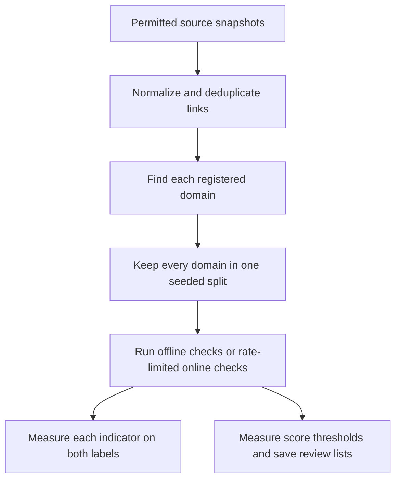
Caption: The split happens after domains are identified, so links from one registered domain cannot leak between training and testing.

The data builder groups all links by registered domain before splitting. Imagine a practice exam where several questions all come from one shop. If some of those shop links went into practice and others into the test, the program could learn that shop's name and then appear to generalize. Keeping the whole domain in one group makes that particular shortcut harder. A fixed random seed and the saved Tranco list ID make the split repeatable.

The offline mode uses only local parsers and the UPI analyzer. The online mode calls the existing fast-path service for DNS/registration and prior threat reports. It limits the overall rate to at most four scans a minute, can resume from a local progress file, and does not submit URLs for new VirusTotal scans. Both modes write per-indicator hit rates, score metrics at six thresholds, a precision-recall PNG, and local CSV files for up to 25 false alarms and 25 missed examples.

### 4. Decisions and reasoning
| decision | options considered | why we chose this | trade-off |
|---|---|---|---|
| Split by registered domain | Randomly split rows or keep related domains together | Related links from one site must not appear in both train and test. | A few very large domains can make split sizes uneven. |
| Keep source-derived files local | Commit a convenient snapshot or respect the source terms | Some feeds forbid redistribution or restrict use; generated splits and raw files are ignored by Git. | Reviewers need eligible credentials and a local build to reproduce them. |
| Require explicit OpenPhish terms acknowledgment | Download automatically or require an opt-in | The community feed's terms limit use and prohibit redistribution without permission. | A build without acknowledgment has no OpenPhish rows. |
| Report synthetic metrics separately | Blend hand-built examples with real feeds or label them separately | Hand-built cases are useful for parser checks, not representative population estimates. | They cannot answer how the system performs in the wild. |
| Keep the locked split out of tuning | Repeatedly adjust thresholds against the test set or reserve it | Reusing test examples to pick thresholds makes the reported score misleading. | Threshold development needs separate train/dev data. |

### 5. What we built
- `link-security-analyzer/eval/build_dataset.py`: source-aware downloads, terms notes, URL deduplication, Tranco rank sampling, and fixed-seed registered-domain splits.
- `link-security-analyzer/eval/run_eval.py`: offline and rate-limited online runners, resumable online progress, per-indicator rates, threshold metrics, review CSVs, and a precision-recall PNG.
- `link-security-analyzer/eval/data/india_manual.csv`: 40 synthetic rows, split evenly between constructed malicious and benign scenarios.
- `link-security-analyzer/backend/tests/test_evaluation.py`: mocked source builder, split-leakage, metrics, output, resume, and offline UPI tests.
- `.gitignore`: excludes downloaded feed data, generated splits, and evaluation outputs from commits.
- `link-security-analyzer/README.md`: data source terms, evaluation commands, architecture, indicator descriptions, privacy, integration, and limits.
- `README.md`: API quick start and project-journal link.
- `docs/PROJECT_JOURNAL.md`: this evaluation report and the whole-system recap.

### 6. What actually happened
The source terms were checked on the sources' official pages. OpenPhish's terms permit only qualifying personal or academic research and prohibit commercial use and redistribution without written permission. The builder therefore requires an explicit research-terms acknowledgment and keeps all resulting rows local. URLhaus requires authentication for its community API, limits free use to qualifying non-profit purposes, and prohibits using its data to train an AI model without prior written consent. The optional PhishTank feed needs an API key; its current terms point to Cisco's end-user agreement, so users must review that agreement before use. Tranco's API provides dated, reproducible lists; the official pages checked did not state a separate data license, so the list ID is recorded and attribution retained.

The Tranco list returned list ID `56Z8N`. Its response was plain CSV rather than a ZIP archive, which exposed an initial parser assumption; the parser was corrected to accept either format. It contained **99,000 entries in ranks 1,001 through 100,000**, and the rank filter was checked. No URLhaus or PhishTank keys were configured, and OpenPhish was skipped because its terms were not acknowledged. The final source-builder run correctly stopped with "No malicious examples were obtained" and wrote no empty or synthetic `test_locked.csv`. Consequently, no source-backed locked split or source-backed online metrics exist yet.

The offline run measured the manually constructed set: **40 rows, 20 malicious-label scenarios and 20 benign-label scenarios, all `synthetic=true`**. Seven web-link rows had unavailable checks because the URL lexical analyzer is absent and offline mode does not query infrastructure or threat feeds. This is a parser/rule sanity check, not a realistic performance estimate.

Per-indicator results on that synthetic set:

| Indicator code | Malicious hit rate | Benign hit rate |
|---|---:|---:|
| `DOMAIN_VERY_NEW` | 0/20 (0%) | 0/20 (0%) |
| `FAST_FLUX_LIKE` | 0/20 (0%) | 0/20 (0%) |
| `FORM_POSTS_OVER_HTTP` | 0/20 (0%) | 0/20 (0%) |
| `FORM_POSTS_TO_DIFFERENT_DOMAIN` | 0/20 (0%) | 0/20 (0%) |
| `GSB_MATCH` | 0/20 (0%) | 0/20 (0%) |
| `HIDDEN_IFRAME` | 0/20 (0%) | 0/20 (0%) |
| `INVALID_VPA_FORMAT` | 0/20 (0%) | 0/20 (0%) |
| `MALFORMED_UPI_URI` | 0/20 (0%) | 0/20 (0%) |
| `META_REFRESH_REDIRECT` | 0/20 (0%) | 0/20 (0%) |
| `MISSING_TRANSACTION_REF` | 5/20 (25%) | 0/20 (0%) |
| `NEW_DOMAIN_LOGIN_FORM` | 0/20 (0%) | 0/20 (0%) |
| `NON_INR_CURRENCY` | 0/20 (0%) | 0/20 (0%) |
| `NO_A_RECORD` | 0/20 (0%) | 0/20 (0%) |
| `NO_MX_RECORD` | 0/20 (0%) | 0/20 (0%) |
| `PASSWORD_FIELD_PRESENT` | 0/20 (0%) | 0/20 (0%) |
| `PAYEE_NAME_BRAND_MISMATCH` | 10/20 (50%) | 0/20 (0%) |
| `PREFILLED_AMOUNT` | 4/20 (20%) | 4/20 (20%) |
| `REDIRECT_CHAIN_LONG` | 0/20 (0%) | 0/20 (0%) |
| `REDIRECT_CROSS_DOMAIN` | 0/20 (0%) | 0/20 (0%) |
| `REDIRECT_TO_SHORTENER` | 0/20 (0%) | 0/20 (0%) |
| `REGISTRAR_PRIVACY_PROXY` | 0/20 (0%) | 0/20 (0%) |
| `SANDBOX_BLOCKED_REQUEST` | 0/20 (0%) | 0/20 (0%) |
| `SANDBOX_BYTE_LIMIT_REACHED` | 0/20 (0%) | 0/20 (0%) |
| `SENSITIVE_FIELD_REQUESTED` | 0/20 (0%) | 0/20 (0%) |
| `SUSPICIOUS_NOTE_TEXT` | 9/20 (45%) | 0/20 (0%) |
| `UNKNOWN_PSP_HANDLE` | 4/20 (20%) | 0/20 (0%) |
| `UPI_COLLECT_REQUEST` | 5/20 (25%) | 0/20 (0%) |
| `UPI_EMBEDDED_IN_WEB_URL` | 0/20 (0%) | 0/20 (0%) |
| `VISUAL_BRAND_IMPERSONATION` | 0/20 (0%) | 0/20 (0%) |
| `VISUAL_SIMILARITY_WEAK` | 0/20 (0%) | 0/20 (0%) |
| `VT_MALICIOUS_VENDORS` | 0/20 (0%) | 0/20 (0%) |

Score threshold results on the same 40 synthetic rows:

| Threshold | Precision | Recall | F1 | False-positive rate |
|---:|---:|---:|---:|---:|
| 0.05 | 0.800 | 0.800 | 0.800 | 0.200 |
| 0.10 | 1.000 | 0.800 | 0.889 | 0.000 |
| 0.20 | 1.000 | 0.650 | 0.788 | 0.000 |
| 0.30 | 1.000 | 0.600 | 0.750 | 0.000 |
| 0.50 | 0.000 | 0.000 | 0.000 | 0.000 |
| 0.75 | 0.000 | 0.000 | 0.000 | 0.000 |

On these constructed cases, payee-name mismatch and suspicious-note signals covered many labeled examples without benign hits; collect and unknown-handle signals covered fewer. `PREFILLED_AMOUNT` did not separate the labels: it appeared in 20% of both groups. At threshold 0.05 the four worst false alarms were benign small-amount links (`IN027`–`IN030`); they show why treating every prefilled amount as decisive would cry wolf. At threshold 0.10 and above there were no false alarms in this small set, but recall fell as the threshold rose. At 0.05, the missed cases were `IN011` and three synthetic short-link URLs (`IN018`–`IN020`). `IN011` was missed because the current name comparison sees "icici" in the configured `okicici` handle and does not notice that the local part is unrelated. The three short-link examples were unavailable to the missing URL lexical analyzer, so they received no detecting URL signal. These are examples from constructed cases, not confirmed real-world failures.

The complete backend test run and the separately marked browser test reported:

```text
$ python -m pytest -q
........................................................................ [ 42%]
........................................................................ [ 84%]
...........................                                              [100%]
171 passed, 1 deselected in 11.48s

$ python -m pytest -q -m integration
.                                                                        [100%]
1 passed, 171 deselected in 11.34s
```

Ruff reported `All checks passed!`; the changed evaluation scripts and test file passed `ruff format --check`. A broader format-only check also identified pre-existing formatting in `backend/app/core/threat_feeds.py` and `backend/app/db/models.py`; they were not changed because they are outside this chunk. The evaluation tests use mocked feeds; no OpenPhish, URLhaus, or PhishTank malicious URLs were downloaded. The precision-recall image and CSV reports are local under `eval/results/` and git-ignored.

### 7. Limits and honest weaknesses
1. There is no URL lexical analyzer in this checkout, so website spelling clues are unavailable. We also could not make a permitted source-backed malicious test set, so there is no honest real-world URL precision or recall yet.
2. The 40-row Indian set is hand-constructed from the same rules being checked. Its strong-looking values cannot be generalized. Its labels encode expected patterns, not independent expert judgments.
3. The fixed score is uncalibrated and the rules have gaps: small legitimate amounts trigger the amount indicator, brand-name matching can miss an unrelated VPA local part, and higher score thresholds missed more synthetic positives. Visual and online-only indicators had no offline examples.

### 8. How to explain this to a judge in 30 seconds
We built a repeatable evaluator that keeps each domain entirely in one data split and reports both catches and false alarms. We ran it on 40 clearly marked synthetic Indian examples and published the actual counts. Those results test that the plumbing works, not how well the system handles real scams. We did not invent a real-world score when the licensed feed access and URL lexical code were unavailable.

### 9. New terms
- Precision: the share of flagged examples that truly belong to the positive label.
- Recall: the share of positive examples the checker finds.
- False-positive rate: the share of negative examples incorrectly flagged.
- Data leakage: information from the test set accidentally influencing training or threshold choices.
- Locked test split: examples reserved for final measurement, not for tuning.
- Synthetic: deliberately constructed sample data that does not represent observed users or real incidents.
- Precision-recall curve: a graph showing how precision and recall change as the score threshold changes.

## Chapter 10: Whole-system recap and demo guide
Date: 2026-10-24 | Commit message: chunk-9: evaluation, documentation and final recap
### 1. In one minute
TrueIntent accepts a URL, UPI link, or pasted QR text and organizes observed clues into technical, visual, and transaction-context pillars. Quick checks return first; a background browser can add page behavior and a visual fingerprint later. The system uses cautious wording and keeps screenshots out of storage. This is still a staged prototype: the URL lexical analyzer and the Next.js interface are not implemented in this checkout.

### 2. Why we did this
A single clue list is easier for a person and later software to understand than a hidden yes/no verdict. Separating the quick response from the slower browser visit keeps the API responsive. The safeguards, availability states, and explicit limitations matter because a hostile link can target the system itself, and a false sense of certainty can harm the person using it.

### 3. How it works
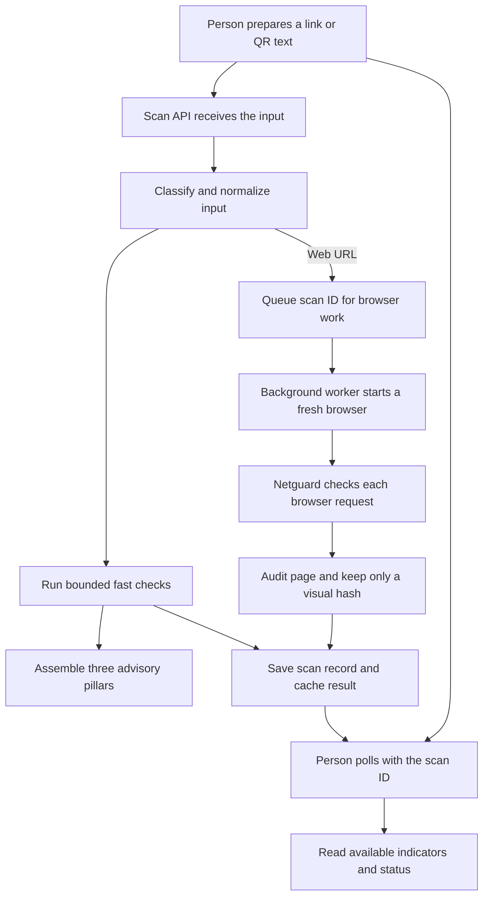
Caption: The quick report and the later browser findings share one saved job; the browser's network requests pass through netguard.

### 4. Decisions and reasoning
| decision | options considered | why we chose this | trade-off |
|---|---|---|---|
| Report indicators, not verdicts | One definitive label or separate clues | A clue does not prove intent, and missing checks must remain visible. | The user must use judgment and official contact channels. |
| Return a fast result and continue browser work in the background | Wait for every check or return an early report | Browser loading can be slow and needs separate resource limits. | A first report can have pending or unavailable pillars. |
| Keep the score internal | Display it as a probability or omit it from the user response | Its weights have not been statistically calibrated. | Later fusion work must retain this caveat. |
| Demo through the API for now | Pretend a user interface is complete or show the working API boundary | The frontend task is not implemented; the API is the available interface. | This is not yet a polished judge-facing web demonstration. |
| Give only verified contact references | Guess a helpline number or leave it out | An incorrect emergency contact can delay help. | This chapter does not supply a national helpline reference. |

### 5. What we built
- `README.md`: repository-level API quick start and journal link.
- `link-security-analyzer/README.md`: architecture, indicator dictionary, privacy flow, source terms, run/test/evaluation instructions, library contract, and limitations.
- `docs/PROJECT_JOURNAL.md`: final recap, API demo guide, and likely judge questions.

### 6. What actually happened
The backend suite passed **171 tests**, with the one browser integration test deselected in the standard run and passing when run separately. The local browser test uses an explicitly enabled test-only loopback argument; production paths do not enable it. Ruff lint passed; changed evaluation files passed formatting checks.

The demo commands below were documented but not run against a live Docker deployment in this chunk. Docker runtime availability was not verified here. The frontend Compose service remains a placeholder; there is no interactive page to screenshot, so no UI screenshots were captured. API behavior is covered by mocked tests, but a full live-stack demo should be verified on a machine with Docker and the required services.

### 7. Limits and honest weaknesses
- The Next.js frontend has not been built. The Compose frontend entry still sleeps instead of serving a page.
- The URL lexical analyzer is absent. URL spelling results are therefore unavailable, as confirmed by the evaluation.
- No source-backed locked dataset was generated; external feed evaluation and real-world accuracy remain unverified.
- A heuristic score is uncalibrated and is not a probability.
- The browser uses netguard per request, but DNS rebinding between validation and connection remains possible. The browser worker shares a Docker network with Redis and PostgreSQL; production needs egress firewalling and stronger network isolation.
- Perceptual hashes are fragile under cookie banners, A/B tests, screen-size changes, language variants, and dynamic content.
- The offline synthetic evaluation found the expected policy tension: at 0.05 the false-positive rate was 20%, while a higher threshold reduced false alarms but missed more labeled examples.

### 8. How to explain this to a judge in 30 seconds
Paste a link into the API, receive a scan ID and quick clues, then poll that ID for the saved report. The report separates address and infrastructure clues, page-appearance clues, and UPI transaction details. A guarded background browser can add page observations. We do not call a link safe or fraudulent, do not keep screenshots, and do not present our rule score as a probability. The evaluator is currently limited to synthetic results until permitted external data and the missing URL analyzer are available.

#### Demo script (API only)
1. From `link-security-analyzer/`, copy `.env.example` to `.env` and start PostgreSQL, Redis, the API, and the worker with `docker compose up --build postgres redis backend worker`. Fill in any optional provider credentials only in the private `.env` file.
2. Open `http://localhost:8000/docs`, or paste this harmless placeholder in the request body: `{"input":"https://example.com"}`.
3. Send `POST http://localhost:8000/api/v1/scan`. Show the returned `scan_id`, `status`, summary, and `poll_url`.
4. Poll the returned URL about every 1.5 seconds. Show the technical, visual, and transaction-context cards as pillars in the API report; depending on which checks ran, their statuses may be pending, unavailable, not applicable, or contain indicators.
5. Explain: "These are automated indicators, not a verdict. A missing check is not a clean result. Please contact an organization through its official number before paying or logging in."

The Next.js screen and its requested visual screenshot are **not implemented / not captured**. If a local API or worker is unavailable, do not present an unverified response as a live result.

#### Likely judge questions
1. **Why not just use Google Safe Browsing?** It is one useful source, and the system can look up its existing reports when configured. It does not provide the UPI-field, DNS/registration, browser-form, or visual-layout clues, and a missing listing is not proof that a page is harmless.
2. **What about false alarms?** They are a real failure mode. We show indicators rather than final labels, measure false-positive rates, and found four benign low-amount examples flagged at the synthetic 0.05 threshold. Those results are not enough to calibrate production thresholds.
3. **How do you stop your server being attacked by hostile links?** Netguard checks the initial destination and each browser request, blocks private/special address types, and the worker uses a fresh bounded browser context. DNS can still change between check and connection, and the shared Docker network needs production firewalling.
4. **What is the score, and can I trust it?** It is a fixed-weight internal heuristic. It is explicitly uncalibrated, is not a probability, and should not be displayed as a percentage.
5. **What is a UPI collect request?** It asks the recipient to pay, unlike a normal pay link that initiates a payment from the payer. It is often disguised as a refund; a person never needs a PIN to receive money.
6. **Do you store page screenshots?** No. The screenshot exists in memory long enough to compute a perceptual hash, then is discarded. The hash and selected page features are stored.
7. **Does no indicators detected mean there is no risk?** No. It means these checks did not report a clue. A check may be unavailable, and new or unobserved behavior may not be covered.
8. **What data leaves the service?** The input is stored in the scan record. When enabled, Safe Browsing and VirusTotal receive lookup requests containing the submitted address. VirusTotal is queried for an existing report; this code does not ask it to scan or upload the URL.
9. **Why split test data by domain?** Links from the same site often share structure. If that site's examples appeared in both practice and test, the test score could reward memorization rather than useful generalization.
10. **Are these accuracy numbers real?** The reported metrics are from 40 synthetic examples made for parser and rule checks. A real source-backed test split was not produced, so no real-world accuracy claim is justified.
11. **Why is the visual check weak?** Cookie banners, layout experiments, localization, dynamic content, and different screen sizes can change a page image. A similar hash is supporting evidence, not proof.
12. **What would you do next?** Implement and test URL lexical analysis; obtain and follow suitable data permissions; evaluate a larger domain-separated set; calibrate or train a model on permitted `signal_vector` examples; finish the Next.js screen; and combine Module A with the separate text-scam engine.

### 9. New terms
- FastAPI: the web framework that receives scan requests and returns report data.
- Redis: a shared in-memory store used here for caching and queued task messages.
- Celery: the background job runner that performs slower browser work.
- Netguard: the server-side destination checker that blocks private or special network addresses.
- Signal vector: a flat collection of numeric and boolean facts for later analysis.
- Egress firewall: a network rule that controls where a service is allowed to connect.