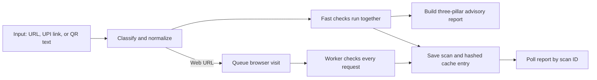

# TrueIntent Module A

Module A reports explainable indicators about URLs, UPI links, and QR text. It
does not make a final judgment about a link or the user's situation.

## Sandbox threat model

The browser worker opens hostile pages in a disposable, non-root Chromium
context. A fresh context is created for each scan and then closed. Every HTTP
or HTTPS request is checked with netguard before the route is allowed to
continue. Other schemes, WebSockets, media, and downloads are blocked. The
worker does not save page screenshots: it retains a perceptual hash in the
scan's sandbox feature data, never the image itself.
The loopback exception used in the integration test is a private function
argument that defaults to off. It is not an environment setting, and neither
the API nor the Celery task supplies it.

The container uses the non-root `pwuser`, Playwright's Chromium sandbox
(`chromium_sandbox=True`), and the Playwright 1.63.0 seccomp profile from
[`backend/seccomp_profile.json`](backend/seccomp_profile.json). The profile is
the version-matched profile distributed with the official Playwright Docker
support files ([source](https://github.com/microsoft/playwright/blob/v1.63.0/utils/docker/seccomp_profile.json)).
The worker also has CPU, memory, shared-memory, and temporary
filesystem limits in `docker-compose.yml`. These settings have not been
runtime-verified here because Docker Desktop's Linux engine was unavailable.

| Threat | What we do | Residual risk |
|---|---|---|
| A page asks the worker to visit a private or local address | Netguard validates the initial URL and each intercepted request, including redirects and subresources; blocked requests are reported. | DNS can change between validation and Chromium's connection (DNS rebinding). This check-to-connect gap is not fully solved. |
| A page uses a non-web scheme, socket, media stream, or download | Only HTTP/HTTPS requests are continued; WebSockets, media, and downloads are disabled. | Browser bugs or network mechanisms not exposed as routed HTTP requests remain possible; production egress filtering is still required. |
| A hostile page escapes the browser process | Run as non-root, enable Chromium's own sandbox, apply the versioned seccomp profile, and constrain resources. No `--no-sandbox` override is used. | The container and browser are not a complete security boundary; the exact host kernel and Docker configuration matter. Chromium sandbox enablement was configured but not verified in a running container. |
| A compromised worker reaches other services | The worker has no published port and requests pass the URL guard. | The worker shares a Docker network with Redis and PostgreSQL. For production, place it on a restricted network and add an egress firewall rule allowing only public web traffic needed for scans, while denying private, link-local, and service-network ranges. |
| Private scan data is retained in an image | Screenshots exist only in memory; sandbox features retain the perceptual hash and host-only navigation metadata, never image bytes. | Page text and request destinations are transiently processed by Chromium; this does not remove browser or memory risks. |

Production deployments should additionally isolate the worker from the database
and cache networks, limit outbound connections at the host or cloud firewall,
and review the browser image and seccomp profile on every upgrade.

## Brand reference fingerprints

The checked-in seed list is [`backend/data/brand_seed.yaml`](backend/data/brand_seed.yaml).
From `backend/`, run `python -m scripts.seed_brands --verify-only` to load each
official page through the guarded browser and print its result without writing
to the database. Run `python -m scripts.seed_brands` to add successful
fingerprints, or add `--refresh` to replace a brand's old references only if
all of that brand's configured pages loaded successfully. A `HUMAN_REVIEW`
row means the page could not be safely loaded or did not finish on a configured
official domain; no fingerprint is silently invented.

The visual comparison uses a Hamming-distance threshold of 10 bits out of 64.
Page layout hashes are fragile: cookie banners, A/B tests, localization,
responsive layout, and dynamic content can change the image. Treat this pillar
as supporting evidence, not a stand-alone result.

## Architecture and data flow


Caption: Fast checks return first; a web-page visit may later add browser evidence to the stored report.

The user input is sent to this API and retained in the scan-job database record.
If API keys are configured, Google Safe Browsing and VirusTotal receive lookup
requests containing the submitted address. VirusTotal is queried only for an
existing report; this code does not upload a URL for scanning. Infrastructure
checks resolve hostnames, and the background browser opens web links through
the request guard. The Redis cache key is a SHA-256 digest of normalized input.
Page screenshots are processed in memory and discarded; only a perceptual
hash and restricted page features are retained.

## What the three pillars say

- **Technical URL analysis** groups address spelling, registration age, DNS,
  and prior threat-feed matches. Examples include domain-age and DNS signals,
  Google Safe Browsing (`GSB_MATCH`), and VirusTotal (`VT_MALICIOUS_VENDORS`).
- **Visual brand analysis** compares an in-memory page fingerprint with
  references from known official domains. `VISUAL_BRAND_IMPERSONATION` means
  the page resembles a reference while using another domain; the weaker
  `VISUAL_SIMILARITY_WEAK` is a smaller signal.
- **Transaction context analysis** describes fields in UPI links. Examples
  include `UPI_COLLECT_REQUEST`, `PREFILLED_AMOUNT`,
  `INVALID_VPA_FORMAT`, `UNKNOWN_PSP_HANDLE`,
  `PAYEE_NAME_BRAND_MISMATCH`, `MISSING_TRANSACTION_REF`,
  `NON_INR_CURRENCY`, `SUSPICIOUS_NOTE_TEXT`, and
  `UPI_EMBEDDED_IN_WEB_URL`.

The table below explains every stable indicator code currently present in the
backend. Check-unavailable indicators describe missing evidence, not a link's
behavior. Every indicator uses the same code, severity, message, and evidence
structure.

| Indicator | Plain meaning |
|---|---|
| `CHECK_UNAVAILABLE` | A particular analysis could not be completed. |
| `DNS_LOOKUP_UNAVAILABLE` | The name-server lookup did not return usable information. |
| `DOMAIN_VERY_NEW` | The domain registration appears recent. |
| `FAST_FLUX_LIKE` | The domain returned many addresses with short-lived DNS answers. |
| `FORM_POSTS_OVER_HTTP` | A page form would send information without HTTPS encryption. |
| `FORM_POSTS_TO_DIFFERENT_DOMAIN` | A page form would send information to another domain. |
| `GSB_MATCH` | Google Safe Browsing already has a matching threat report. |
| `HIDDEN_IFRAME` | The page contains a hidden embedded frame. |
| `INFRASTRUCTURE_UNAVAILABLE` | Registration or DNS facts could not be collected. |
| `INVALID_VPA_FORMAT` | The payment address does not fit the expected VPA shape. |
| `MALFORMED_UPI_URI` | The UPI link could not be parsed as a supported payment link. |
| `META_REFRESH_REDIRECT` | The page asks a browser to redirect after a delay. |
| `MISSING_TRANSACTION_REF` | The payment link has no transaction reference field. |
| `NEW_DOMAIN_LOGIN_FORM` | A recently registered domain presents a login-like form. |
| `NON_INR_CURRENCY` | The payment link specifies a currency other than Indian rupees. |
| `NO_A_RECORD` | DNS did not return an IPv4 address for the domain. |
| `NO_MX_RECORD` | DNS did not return a mail-server record; many legitimate sites have none. |
| `PASSWORD_FIELD_PRESENT` | The page includes a password-entry field. |
| `PAYEE_NAME_BRAND_MISMATCH` | The displayed payee name uses an authority or brand term not seen in the VPA. |
| `PREFILLED_AMOUNT` | The payment link includes an amount that was filled in ahead of time. |
| `REDIRECT_CHAIN_LONG` | The browser passed through several hosts before reaching the page. |
| `REDIRECT_CROSS_DOMAIN` | The page navigation crossed between registered domains. |
| `REDIRECT_TO_SHORTENER` | The navigation passed through a known URL-shortening service. |
| `REGISTRAR_PRIVACY_PROXY` | Registration details use a privacy or proxy service. |
| `SANDBOX_BLOCKED_REQUEST` | The browser guard stopped a page request. |
| `SANDBOX_BYTE_LIMIT_REACHED` | The browser stopped after reaching its response-size limit. |
| `SANDBOX_UNAVAILABLE` | The browser inspection did not finish. |
| `SENSITIVE_FIELD_REQUESTED` | The page asks for a sensitive value such as an OTP or card detail. |
| `SUSPICIOUS_NOTE_TEXT` | A payment note includes urgency, refund, or account-verification words. |
| `THREAT_FEED_UNAVAILABLE` | A prior-report lookup was unavailable. |
| `UNKNOWN_PSP_HANDLE` | The VPA handle is not in the configured handle list. |
| `UPI_COLLECT_REQUEST` | The UPI action is a collect-style request that asks the recipient to pay. |
| `UPI_EMBEDDED_IN_WEB_URL` | An HTTPS address carries UPI payment fields in its query. |
| `VISUAL_BRAND_IMPERSONATION` | The page layout resembles a brand reference on another domain. |
| `VISUAL_SIMILARITY_WEAK` | The page is somewhat close to a brand reference, but below the main threshold. |
| `VT_MALICIOUS_VENDORS` | VirusTotal's existing report lists detections by some security vendors. |
| `WHOIS_TIMEOUT_OR_UNAVAILABLE` | Public domain registration details could not be retrieved in time. |

Some indicators describe unavailable checks rather than link behavior. A
missing mail record or a privacy proxy is not proof of wrongdoing. The report
describes clues, not certainty. User-facing text must say "indicators
detected", "no indicators detected", or "inconclusive"; it must not promise an
outcome or label a person or page. An uncalibrated heuristic score is an
internal engineering feature, not a probability and not a user-facing
percentage.

## Run and test

From this directory, copy `.env.example` to `.env` and start the API stack:

```powershell
Copy-Item .env.example .env
docker compose up --build postgres redis backend worker
```

The frontend is not implemented yet, and the frontend Compose service remains
a placeholder. Use `http://localhost:8000/docs` or a `POST /api/v1/scan`
request followed by `GET` on the returned `poll_url`. A sample input such as
`https://example.com` is for demonstration only; live provider results depend
on API keys and network availability.

```powershell
$accepted = Invoke-RestMethod -Method Post `
  -Uri "http://localhost:8000/api/v1/scan" `
  -ContentType "application/json" `
  -Body (@{ input = "https://example.com" } | ConvertTo-Json)
Invoke-RestMethod -Uri ("http://localhost:8000" + $accepted.poll_url)
```

Run the backend tests from `backend/`:

```powershell
python -m pytest -q
python -m pytest -q -m integration
```

Evaluation tools are in `eval/`. Generate local source-backed splits with
`python eval/build_dataset.py`; the OpenPhish community feed is skipped unless
`--accept-openphish-research-terms` is supplied. URLhaus needs
`URLHAUS_AUTH_KEY`, and PhishTank is used only when `PHISHTANK_API_KEY` is
configured. Do not commit generated feed-derived CSV files: their terms and
contents can restrict redistribution. Tranco benign examples are sampled only
from ranks 1,001 to 100,000. The builder fixes its random seed and assigns all
links from a registered domain to one split.

Run pure local analysis with
`python eval/run_eval.py --offline --dataset eval/data/india_manual.csv`.
Run external online checks only against a permitted local split with
`python eval/run_eval.py --online --dataset eval/data/test_locked.csv --resume`.
The online runner caps calls at four per minute and checkpoints results for
resumption. Generated reports are in `eval/results/`, which is git-ignored.
Never use `test_locked.csv` to choose or tune thresholds.

The data sources have different terms. OpenPhish's terms restrict use to
permitted personal or academic research and prohibit redistribution without
permission. URLhaus requires authentication for its community API, limits free
use to qualifying non-profit use, and prohibits using its data to train AI
without prior written consent. PhishTank's page points to Cisco's current
end-user agreement; check it before use. Tranco's API documents dated,
reproducible lists, but the official pages checked for this chunk did not state
a separate dataset license. The builder prints these notes and keeps the raw
downloads and generated splits local.

## Integration contract for other modules

Call the library function from Python with an async runtime:

```python
from app.core.service import run_fast_path

result = await run_fast_path("https://example.com")
report = result.advisory_report
vector = report.signal_vector
internal_score = report.heuristic_score
```

`signal_vector` is a flat dictionary containing available numeric or boolean
signals. Current common fields are `shannon_entropy`,
`domain_age_days` (-1 means unknown), `subdomain_depth`, `is_punycode`,
`gsb_match_count`, `vt_malicious_count`, `upi_collect_request`,
`upi_prefilled_amount`, and the three `payload_is_*` flags. It can also
contain `indicator_<code>` flags and `infrastructure_*` fields when those
checks return them. The exact key set can grow as checks are added.

`heuristic_score` is a weighted, uncalibrated rule score in the 0-to-1 range.
It has not been calibrated against representative real examples and must not
be interpreted or displayed as a probability. The eventual fusion layer may
combine `signal_vector` with a separately trained text-scam model. URL
lexical-analysis code is currently absent, so URL spelling results are
reported as unavailable rather than guessed.

## Known limitations

- The URL lexical analyzer is missing; URL spellings are not currently
  evaluated by that pillar.
- WHOIS/RDAP and DNS checks can time out or return unknown; missing data is
  not evidence for either class.
- The heuristic uses fixed rule weights and has not been statistically
  calibrated. External labeled evaluation was not run for this snapshot.
- Visual pHash is fragile to cookie banners, A/B tests, localization, screen
  size, and dynamic page content. It is a supporting clue only.
- DNS can change after netguard checks a name but before Chromium connects
  (DNS rebinding); the race is not fully eliminated.
- The worker shares a Docker network with Redis and PostgreSQL. Production
  deployments need network isolation and outbound firewall controls.
- No automated evaluation can establish a person's intent or the full context
  of a payment link.
